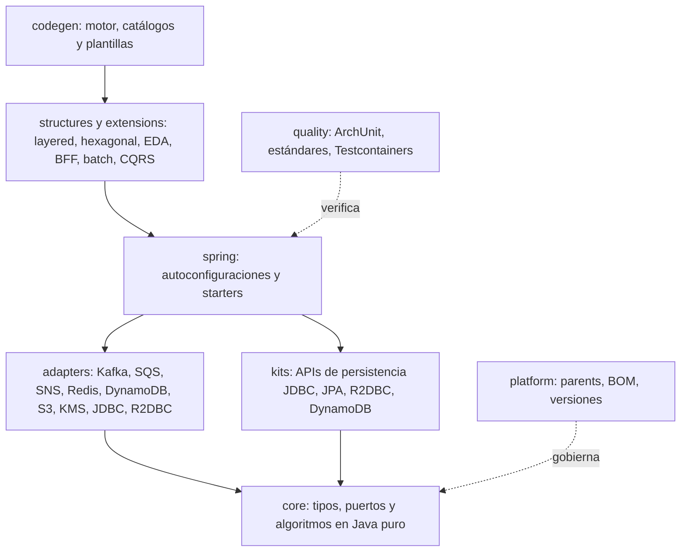
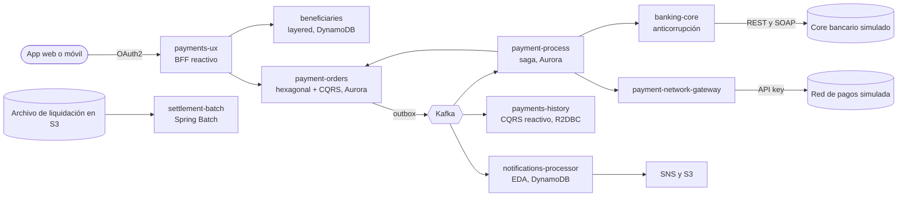

# Axiz

Axiz es un framework para construir servicios backend financieros con Java 25 y Spring Boot 4.1.
Reúne en un mismo repositorio las librerías del framework, las herramientas que generan y
mantienen servicios, una demo de pagos que usa todas las capacidades y la documentación.

Un servicio construido con Axiz parte de un contrato OpenAPI, se genera con una estructura
conocida (layered, hexagonal, EDA, BFF o batch) y recibe capacidades listas para producción:
seguridad OAuth2, errores RFC 9457, dinero exacto, enmascaramiento de datos sensibles, auditoría
encadenada, outbox e inbox, idempotencia, locks, sagas, observabilidad y reglas de arquitectura
que se verifican en cada build.

## Caso de uso de la demo

La demo `axiz-demo` implementa un procesador de pagos inmediatos. Un cliente registra
beneficiarios frecuentes y les paga desde el canal web o móvil. El pago se registra como una
orden, una saga lo procesa (debita la cuenta en el core bancario y envía la transferencia a la
red interbancaria), el resultado se notifica al cliente, cada operación queda auditada y el
estado se proyecta en un historial de consulta. Un proceso batch concilia el archivo diario de
liquidación de la red.

Técnicamente, el flujo recorre llamadas HTTP con propagación de token, eventos CloudEvents
sobre Kafka publicados mediante outbox transaccional, consumo idempotente con inbox, una saga
orquestada con compensaciones y recuperación, integraciones REST y SOAP con sistemas externos
simulados, y un modelo de lectura reactivo sobre R2DBC. Todos los nombres, cuentas y datos son
ficticios.

## Tecnologías principales

| Tecnología | Uso en Axiz |
|---|---|
| Java 25 | Lenguaje base; hilos virtuales en servicios servlet |
| Spring Boot 4.1 | Autoconfiguración de las capacidades y composición de cada servicio |
| Spring WebFlux y Reactor | Servicios reactivos (BFF y modelo de lectura) |
| PostgreSQL (Aurora) | Persistencia con JDBC, JPA o R2DBC y migraciones Flyway |
| DynamoDB | Repositorios con paginación por cursor, idempotencia, locks e inbox |
| Kafka (MSK), SQS y SNS | Eventos CloudEvents, outbox, inbox y colas de mensajes fallidos |
| Redis (Valkey) | Caché de segundo nivel, idempotencia, locks y límites de tasa |
| Keycloak | Proveedor OAuth2/OIDC local que emite tokens de clientes y servicios |
| OpenTelemetry y Micrometer | Trazas, métricas y logs correlacionados, exportados por OTLP |
| LocalStack | S3, SQS, SNS, DynamoDB, KMS y Secrets Manager en local |
| WireMock | Core bancario (REST y SOAP) y red de pagos simulados |
| Testcontainers | Pruebas de integración contra la infraestructura real en contenedores |
| Jib, Docker Compose, kind y Helm | Imágenes, ejecución local y despliegue en Kubernetes |
| ArchUnit, Error Prone, NullAway, SpotBugs, PIT y JaCoCo | Reglas de arquitectura, análisis estático, mutación y cobertura |

## Proyectos del repositorio

| Proyecto | Contenido |
|---|---|
| [axiz-framework](axiz-framework/README.md) | Librerías del framework: 262 módulos Maven organizados en capas |
| [axiz-tools](axiz-tools/README.md) | CLI `axiz`, Initializr web y recetas OpenRewrite que mantienen los servicios alineados |
| [axiz-demo](axiz-demo/README.md) | Nueve servicios de pagos, contratos, infraestructura local, scripts de prueba y despliegue |
| [axiz-docs](axiz-docs/README.md) | Guías, catálogo de capacidades y referencia de módulos publicados con MkDocs |
| [.github](.github/WORKFLOWS.md) | Workflows de build, publicación y despliegue, acciones reutilizables y políticas de seguridad |

Cada proyecto tiene su propio wrapper Maven y se versiona de forma independiente. La
publicación de versiones se describe en [RELEASING.md](RELEASING.md).

## Capas del framework

Las dependencias fluyen en un solo sentido: `core` no conoce Spring ni clientes tecnológicos,
los adaptadores implementan los puertos de `core`, y la capa `spring` compone todo mediante
autoconfiguración. Las reglas de `quality` verifican estas fronteras en cada build.



| Capa | Módulos | Responsabilidad |
|---|---|---|
| [platform](axiz-framework/platform/README.md) | 10 | Parents Maven por tipo de módulo, BOM, versiones de dependencias y esquema SQL compartido |
| [core](axiz-framework/core/README.md) | 41 | Dinero, identificadores, errores, seguridad, datos sensibles, tarjetas, criptografía, tokenización, mensajería, outbox, inbox, saga, idempotencia, locks, secuencias, auditoría, tiempo y observabilidad, sin frameworks pesados (solo SLF4J y Micrometer) |
| [adapters](axiz-framework/adapters/README.md) | 32 | Implementaciones de los puertos de core sobre Kafka, MSK, SQS, SNS, Redis, DynamoDB, S3, KMS, Secrets Manager, JDBC y R2DBC |
| [kits](axiz-framework/kits/README.md) | 7 | APIs de persistencia JDBC, JPA, R2DBC, SQL y DynamoDB con auditoría, cifrado de columnas y bloqueo optimista |
| [spring](axiz-framework/spring/README.md) | 141 | Una autoconfiguración y un starter por capacidad, con propiedades tipadas e integración servlet y reactiva |
| [structures](axiz-framework/structures/README.md) | 9 | APIs y starters de las estructuras layered, hexagonal, EDA, BFF y batch |
| [extensions](axiz-framework/extensions/README.md) | 2 | Extensión CQRS con buses de comandos y consultas, bloqueantes y reactivos |
| [codegen](axiz-framework/codegen/README.md) | 3 | Motor de generación, catálogo de arquetipos y capacidades, plantillas y linter de contratos |
| [quality](axiz-framework/quality/README.md) | 8 | Reglas ArchUnit, pruebas de arquitectura del framework, estándares de código, contratos de stores, Testcontainers y reporte de cobertura |

## Capacidades

Cada capacidad se agrega a un servicio con `axiz add <capacidad>` y se configura con
propiedades `axiz.*`. El detalle de cada una está en el
[catálogo de capacidades](axiz-docs/docs/capacidades/index.md).

| Grupo | Capacidades |
|---|---|
| Base | `foundation` (reloj y calendario de negocio), `web` (cabeceras, correlación, paginación, versionado, JSON estricto), `errors` (RFC 9457 y catálogo de errores), `i18n`, `config`, `config-aws` |
| Observabilidad | `logging` (JSON estructurado con enmascaramiento), `observability` (OpenTelemetry sin agente), `metrics` |
| Seguridad y datos | `security` (resource server OAuth2, autorización previa al binding, límites de tasa), `security-redis`, `sensitive` (enmascaramiento por nivel), `crypto` (cifrado de campos e índices ciegos), `crypto-kms`, `carddata`, `tokenization`, `tokenization-vault`, `tokenization-vault-dynamodb`, `tokenization-vault-redis`, `tokenization-pan`, `tenancy` |
| Secretos | `secrets`, `secrets-file`, `secrets-aws` |
| Persistencia | `jpa`, `jpa-aws`, `r2dbc`, `r2dbc-aws`, `dynamodb`, `dynamodb-cursor`, `sequence`, `storage`, `storage-s3`, `cache`, `cache-redis` |
| Integración | `http-client` (clientes declarativos con OAuth2 y resiliencia), `resilience`, `soap` (WS-Security) |
| Mensajería y consistencia | `messaging`, `messaging-kafka`, `messaging-msk`, `messaging-sqs`, `messaging-sns`, `outbox`, `inbox`, `idempotency`, `idempotency-redis`, `idempotency-dynamodb`, `saga`, `lock`, `lock-redis`, `lock-dynamodb`, `scheduling` |
| Negocio | `audit` (auditoría con cadena HMAC), `audit-kafka`, `audit-sqs`, `featureflags`, `notification` |

## Arquitectura de la demo



| Servicio | Puerto | Estructura | Rol en el flujo |
|---|---|---|---|
| payments-ux | 8080 | BFF reactivo | API del canal; compone beneficiarios y órdenes, propaga el token y enmascara datos |
| payment-orders | 8081 | hexagonal + CQRS, servlet, Aurora | Registra órdenes con número de operación, calendario de corte, cifrado de cuentas y outbox |
| beneficiaries | 8082 | layered, servlet, DynamoDB | Beneficiarios frecuentes con paginación por cursor, borrado lógico e idempotencia |
| banking-core | 8083 | hexagonal, servlet | Capa anticorrupción del core bancario: débitos REST, abonos SOAP, locks por cuenta |
| payment-process | 8084 | hexagonal + saga, servlet, Aurora | Saga del pago: orden en proceso, débito, transferencia y cierre, con compensaciones |
| notifications-processor | 8085 | EDA | Consume eventos, notifica por SNS y archiva la auditoría en S3 |
| payments-history | 8086 | hexagonal + CQRS, reactivo, R2DBC | Modelo de lectura del historial alimentado por Kafka |
| payment-network-gateway | 8087 | hexagonal, servlet | Aísla la red interbancaria con API key e idempotencia en Redis |
| settlement-batch | | batch, CronJob | Carga y concilia el archivo de liquidación de ancho fijo desde S3 |

La saga de `payment-process` ejecuta cuatro pasos. Cada llamada usa una clave de idempotencia
derivada de la orden y del paso, por lo que reintentos, eventos repetidos y sagas reanudadas
tras una caída nunca duplican un efecto.

| Paso | Acción | Compensación |
|---|---|---|
| `processing` | La orden pasa a PROCESSING en payment-orders | La orden pasa a REJECTED |
| `debit` | Se debita la cuenta del cliente en banking-core | Se revierte el débito |
| `transfer` | Se envía la transferencia a la red (paso pivote) | Ninguna |
| `complete` | La orden pasa a COMPLETED | Ninguna; la liquidación concilia un cierre pendiente |

## Estructura del repositorio

```text
.
├── axiz-framework/          librerías del framework
│   ├── platform/            parents, BOM y versiones
│   ├── core/                contratos y algoritmos en Java puro
│   ├── adapters/            implementaciones tecnológicas de los puertos
│   ├── kits/                APIs de persistencia
│   ├── spring/              autoconfiguraciones y starters por capacidad
│   ├── structures/          estructuras de servicio
│   ├── extensions/          CQRS
│   ├── codegen/             motor, catálogos y plantillas
│   ├── quality/             reglas de arquitectura y soporte de pruebas
│   └── docs/api/            inventario de la API pública
├── axiz-tools/              CLI, Initializr y recetas OpenRewrite
├── axiz-demo/
│   ├── contracts/           OpenAPI de cada servicio, AsyncAPI de eventos y sistemas externos
│   ├── services/            los nueve servicios
│   ├── examples/            variantes de proveedores que la demo no necesita
│   ├── coverage/            verificación de que la demo usa todas las capacidades
│   ├── local/               infraestructura y aplicaciones en Docker Compose
│   ├── kind/                despliegue en un clúster kind
│   ├── bruno/               colección de peticiones para Bruno
│   └── scripts/             arranque, pruebas y escaneo de seguridad
├── axiz-docs/               sitio de documentación
├── scripts/build.sh         compilación de todos los proyectos
└── .github/                 workflows, acciones y políticas
```

## Código principal

En el framework, los puntos de entrada más relevantes son:

- `pe.axiz.core.money.Money`: importe exacto con moneda; rechaza escalas inválidas y obliga a
  declarar el redondeo.
- `pe.axiz.core.saga.SagaDefinition` y `SagaOrchestrator`: definición de pasos con acción,
  verificación y compensación; persisten el estado y distinguen un fallo definitivo de uno
  incierto antes de compensar.
- `pe.axiz.core.outbox.OutboxRelay` e `pe.axiz.core.inbox`: publicación al menos una vez desde
  la transacción de negocio y deduplicación en el consumidor.
- `pe.axiz.core.sensitive.SensitiveKeys` y `PanDetector`: clasificación de campos sensibles y
  detección de números de tarjeta en logs, auditoría y respuestas.
- `pe.axiz.core.errors.Failures`: descripción de fallos por tipo y origen, sin mensajes que
  puedan contener datos.
- `pe.axiz.spring.security.AxizSecurityAutoConfiguration`: emisores confiables, audiencias,
  autorización previa al binding y límites de tasa.
- `pe.axiz.codegen.ContractSync` y `OpenApiLinter`: sincronización del código con el contrato y
  reglas del contrato (montos exactos, objetos cerrados, cadenas acotadas, acceso explícito).

En la demo, el recorrido del pago se sigue en estas clases:

| Clase | Servicio | Función |
|---|---|---|
| `PaymentsComposition` | payments-ux | Valida el beneficiario del cliente y registra la orden con el token del usuario |
| `CreatePaymentOrderHandler` | payment-orders | Aplica límites y calendario, numera la operación y publica el evento por outbox |
| `PaymentOrderCreatedHandler` | payment-process | Consume el evento y arranca la saga |
| `PaymentSaga` | payment-process | Define los pasos, verificaciones y compensaciones del pago |
| `SagaRecoveryJob` | payment-process | Reanuda sagas interrumpidas bajo ShedLock |
| `DebitAccountUseCase` | banking-core | Debita con lock por cuenta y traduce los errores del core |
| `PaymentOrderStatusChangedHandler` | payments-history | Proyecta cada cambio de estado en el modelo de lectura |
| `PaymentNotificationHandler` | notifications-processor | Notifica al cliente con su contacto cifrado |

## Endpoints de la demo

Los endpoints se listan en el orden en que participan en el flujo de pago. Los servicios
validan tokens de Keycloak (realm `axiz`); los endpoints de servicio a servicio exigen el scope
`payments:process`, que solo tienen las cuentas de servicio.

| Orden | Método y ruta | Servicio | Descripción funcional | Descripción técnica |
|---|---|---|---|---|
| 1 | `POST /v1/customers/{customerId}/beneficiaries` | beneficiaries | Registra un beneficiario frecuente | Escritura condicional en DynamoDB, `Idempotency-Key` obligatoria |
| 2 | `GET /v1/customers/{customerId}/beneficiaries` | beneficiaries | Lista los beneficiarios del cliente | Paginación por cursor autenticado y ligado a la consulta |
| 3 | `GET /v1/customers/{customerId}/beneficiaries/{beneficiaryId}` | beneficiaries | Consulta un beneficiario | Lectura fuertemente consistente |
| 4 | `PUT /v1/customers/{customerId}/beneficiaries/{beneficiaryId}` | beneficiaries | Cambia el alias | Bloqueo optimista por versión |
| 5 | `DELETE /v1/customers/{customerId}/beneficiaries/{beneficiaryId}` | beneficiaries | Elimina un beneficiario | Borrado lógico |
| 6 | `GET /v1/beneficiaries` | payments-ux | Beneficiarios del cliente autenticado | Composición reactiva, datos enmascarados |
| 7 | `POST /v1/payments` | payments-ux | Paga a un beneficiario | Token relay, idempotencia en Redis, traducción de errores |
| 8 | `GET /v1/payments/{paymentId}` | payments-ux | Estado del pago con su beneficiario | Composición con partes opcionales |
| 9 | `POST /v1/payment-orders` | payment-orders | Registra una orden de pago | JPA, secuencia diaria, cifrado con índice ciego, outbox |
| 10 | `GET /v1/payment-orders` | payment-orders | Órdenes de un cliente | Bus de consultas CQRS, paginación por página |
| 11 | `GET /v1/payment-orders/{orderId}` | payment-orders | Consulta una orden | Autorización por propietario (404 para otros) |
| 12 | `POST /v1/payment-orders/{orderId}/status` | payment-orders | Cambia el estado de la orden | Solo cuentas de servicio; transición validada en el dominio |
| 13 | `POST /v1/payment-processes` | payment-process | Inicia la saga de una orden | Saga persistida con compensaciones |
| 14 | `GET /v1/payment-processes/{processId}` | payment-process | Estado de la saga | Estado y paso fallido |
| 15 | `POST /v1/debits` | banking-core | Debita la cuenta del titular | Cliente REST con client credentials, lock por cuenta, auditoría a SQS |
| 16 | `POST /v1/debits/{movementId}/reversal` | banking-core | Revierte un débito | Compensación idempotente |
| 17 | `POST /v1/credits` | banking-core | Abona en la cuenta | Cliente SOAP con WS-Security |
| 18 | `POST /v1/transfers` | payment-network-gateway | Envía la transferencia interbancaria | API key desde secretos, idempotencia en Redis |
| 19 | `GET /v1/payments/{paymentId}` | payments-history | Estado proyectado del pago | Lectura reactiva en R2DBC |
| 20 | `GET /v1/customers/{customerId}/payments` | payments-history | Historial del cliente | Orden por último cambio |

## Requisitos

El repositorio se ejecuta en Fedora sobre WSL 2 con Docker activo. Los paquetes se instalan con:

```bash
sudo dnf install -y java-25-openjdk-devel git curl jq python3 nodejs
```

Docker se instala con Docker Desktop (integración WSL) o con `docker-ce` dentro de Fedora; en
ambos casos `docker info` debe responder. La demo usa los puertos 8080 a 8087, 8180, 8089, 3000,
4317, 4318, 4566, 5432, 6379 y 9092 de `localhost`. Todos los comandos siguientes se ejecutan desde la raíz
del repositorio.

## Compilación

`scripts/build.sh` compila e instala, en orden, el framework, las herramientas y la demo. El
framework se instala en `~/.m2`, desde donde lo resuelven las herramientas y la demo.

```bash
scripts/build.sh                     # con pruebas unitarias, de integración y controles de calidad
scripts/build.sh --skip-tests        # solo artefactos, sin pruebas ni controles
scripts/build.sh --only framework    # un proyecto: framework, tools o demo
```

Con pruebas, el perfil `quality` ejecuta Spotless, Checkstyle, Error Prone con NullAway,
SpotBugs con FindSecBugs, PIT, JaCoCo, el análisis de dependencias y las reglas ArchUnit; las
pruebas de integración levantan PostgreSQL, Kafka, Redis y LocalStack con Testcontainers. Sin
pruebas, la compilación completa tarda unos minutos y basta para ejecutar la demo.

## Ejecución de la demo

La demo se ejecuta de dos formas. Ambas usan la misma infraestructura local (`axiz-demo/local`):
PostgreSQL, Valkey, Kafka, LocalStack, Keycloak, WireMock y Grafana con OpenTelemetry. Los
secretos locales se generan en `axiz-demo/services/<servicio>/local/secrets` y nunca se
versionan.

### Infraestructura en Docker Compose y servicios en el host

Los servicios se ejecutan como procesos Java en el host, lo que permite depurarlos desde el IDE
y ejecutar los escenarios funcionales, que leen sus logs.

```bash
scripts/build.sh --skip-tests        # una vez, o tras cambiar el framework
axiz-demo/scripts/demo.sh up         # infraestructura, secretos y los ocho servicios
axiz-demo/scripts/demo.sh status     # estado de cada servicio
axiz-demo/scripts/demo.sh logs       # logs de todos los servicios
axiz-demo/scripts/demo.sh down       # detiene servicios y elimina contenedores y volúmenes
```

`demo.sh up` reconstruye solo los jars desactualizados y se detiene antes de arrancar si un
puerto está ocupado, indicando qué proceso lo usa.

### Todo en Docker Compose

Infraestructura, imágenes de los servicios, secretos y datos de ejemplo se levantan con un solo
comando. Al terminar se imprimen todas las rutas disponibles.

```bash
axiz-demo/scripts/compose.sh up --build      # compila los jars, construye las imágenes con Jib y levanta todo
axiz-demo/scripts/compose.sh up --no-build   # usa las imágenes ya construidas
axiz-demo/scripts/compose.sh routes          # vuelve a imprimir las rutas
axiz-demo/scripts/compose.sh status          # salud de cada servicio
axiz-demo/scripts/compose.sh logs payment-process
axiz-demo/scripts/compose.sh down            # elimina contenedores y volúmenes
```

`--build` requiere el framework instalado en `~/.m2` (`scripts/build.sh --skip-tests`). Las
imágenes se publican en Docker local como `axiz/<servicio>:local`.

### Datos precargados y consolas

| Recurso | Acceso |
|---|---|
| Clientes | `ana` (cliente `C-1001`, cuenta `1910012345678`) y `luis` (cliente `C-1002`); contraseña `local-only-<usuario>` |
| Cuenta de servicio | cliente `payment-process`, secreto `local-only-payment-process`, scope `payments:process` |
| Casos de error del core | cuenta `1910099999999` sin fondos (`CB-51`), cuenta `1910088888888` bloqueada (`CB-62`) |
| Caso de error de la red | CCI `00219100123456780052`, cuenta cerrada |
| Keycloak | <http://localhost:8180> (admin `admin` / `local-only`) |
| Grafana | <http://localhost:3000>, tableros de servicios, pagos, mensajería y dependencias |
| WireMock | <http://localhost:8089/__admin/mappings> |

## Pruebas con curl

Los ejemplos se ejecutan en orden en la misma terminal; cada uno reutiliza las variables de los
anteriores. Las respuestas mostradas son reales; identificadores, importes y fechas varían en
cada ejecución.

### Obtención de tokens

Se obtiene un token de cliente para `ana` y `luis` (password grant, solo habilitado en local) y
uno de servicio para `payment-process` (client credentials).

```bash
KC=http://localhost:8180/realms/axiz/protocol/openid-connect/token
ANA=$(curl -s $KC -d grant_type=password -d client_id=payments-web -d username=ana -d password=local-only-ana | jq -r .access_token)
LUIS=$(curl -s $KC -d grant_type=password -d client_id=payments-web -d username=luis -d password=local-only-luis | jq -r .access_token)
M2M=$(curl -s $KC -d grant_type=client_credentials -d client_id=payment-process -d client_secret=local-only-payment-process | jq -r .access_token)
```

### Registro de un beneficiario

Funcional: `ana` registra a su arrendador como beneficiario. Técnico: la clave de idempotencia
garantiza que un reintento no cree un duplicado; un CCI ya registrado responde 409.

```bash
curl -s -X POST http://localhost:8082/v1/customers/C-1001/beneficiaries \
  -H "Authorization: Bearer $ANA" -H 'Content-Type: application/json' \
  -H "Idempotency-Key: $(cat /proc/sys/kernel/random/uuid)" \
  -d '{"alias":"Landlord","holderName":"Ana Torres","cci":"00219100123456789053","currency":"PEN"}' | jq
```

```json
{
  "alias": "Landlord",
  "cci": "00219100123456789053",
  "currency": "PEN",
  "customerId": "C-1001",
  "holderName": "Ana Torres",
  "id": "01a20445-d5c9-71b4-b667-37e52571b819"
}
```

### Consulta y mantenimiento de beneficiarios

Funcional: se listan los beneficiarios, se consulta uno, se cambia su alias y se elimina otro.
Técnico: el listado pagina por cursor, el cambio usa bloqueo optimista y el borrado es lógico
(204 sin cuerpo).

```bash
curl -s "http://localhost:8082/v1/customers/C-1001/beneficiaries?size=20" -H "Authorization: Bearer $ANA" | jq
BEN=$(curl -s "http://localhost:8082/v1/customers/C-1001/beneficiaries?size=20" -H "Authorization: Bearer $ANA" \
  | jq -r '[.items[] | select(.cci == "00219100123456789053")][0].id')
curl -s http://localhost:8082/v1/customers/C-1001/beneficiaries/$BEN -H "Authorization: Bearer $ANA" | jq
curl -s -X PUT http://localhost:8082/v1/customers/C-1001/beneficiaries/$BEN \
  -H "Authorization: Bearer $ANA" -H 'Content-Type: application/json' -d '{"alias":"Landlord"}' | jq
curl -s -o /dev/null -w '%{http_code}\n' -X DELETE \
  http://localhost:8082/v1/customers/C-1001/beneficiaries/<id-de-otro-beneficiario> -H "Authorization: Bearer $ANA"
```

```json
{
  "items": [
    {
      "alias": "Landlord",
      "cci": "00219100123456789053",
      "currency": "PEN",
      "customerId": "C-1001",
      "holderName": "Ana Torres",
      "id": "01a20445-d5c9-71b4-b667-37e52571b819"
    }
  ]
}
```

### Beneficiarios desde el canal

Funcional: el canal muestra los beneficiarios del cliente autenticado. Técnico: el BFF deduce el
cliente del token, propaga ese token a beneficiaries y enmascara el CCI y el titular.

```bash
curl -s http://localhost:8080/v1/beneficiaries -H "Authorization: Bearer $ANA" | jq
```

```json
{
  "items": [
    {
      "alias": "Landlord",
      "creditorCci": "****************9053",
      "currency": "PEN",
      "holderName": "****",
      "id": "01a20445-d5c9-71b4-b667-37e52571b819"
    }
  ]
}
```

### Pago a un beneficiario

Funcional: `ana` paga 150.50 soles a su arrendador. Técnico: payments-ux valida el beneficiario,
payment-orders registra la orden con número de operación y fecha de proceso según el calendario
de corte, y publica el evento por outbox. Repetir la petición con la misma `Idempotency-Key`
devuelve la misma respuesta sin crear otra orden.

```bash
KEY=$(cat /proc/sys/kernel/random/uuid)
curl -s -X POST http://localhost:8080/v1/payments \
  -H "Authorization: Bearer $ANA" -H 'Content-Type: application/json' -H "Idempotency-Key: $KEY" \
  -d "{\"beneficiaryId\":\"$BEN\",\"debtorAccount\":\"1910012345678\",\"amount\":150.50,\"currency\":\"PEN\",\"description\":\"Rent\"}" | tee /tmp/payment.json | jq
PAY=$(jq -r .paymentId /tmp/payment.json)
```

```json
{
  "amount": 150.50,
  "beneficiaryAlias": "Landlord",
  "creditorCci": "****************9053",
  "currency": "PEN",
  "operationNumber": "OP20261122-00000001",
  "paymentId": "01a2044a-c211-726d-addf-b085fa556693",
  "processingDate": "2026-11-23",
  "status": "RECEIVED"
}
```

### Seguimiento del pago

Funcional: el cliente consulta su pago hasta verlo completado. Técnico: la saga corre de forma
asíncrona al consumir el evento; en pocos segundos el estado pasa de RECEIVED a COMPLETED en el
canal, en payment-orders y en la saga.

```bash
until [ "$(curl -s http://localhost:8080/v1/payments/$PAY -H "Authorization: Bearer $ANA" | jq -r .status)" = COMPLETED ]; do sleep 2; done
curl -s http://localhost:8080/v1/payments/$PAY -H "Authorization: Bearer $ANA" | jq
curl -s http://localhost:8081/v1/payment-orders/$PAY -H "Authorization: Bearer $ANA" | jq
curl -s "http://localhost:8081/v1/payment-orders?customerId=C-1001&page=0&size=5" -H "Authorization: Bearer $ANA" | jq
curl -s http://localhost:8084/v1/payment-processes/$PAY -H "Authorization: Bearer $M2M" | jq
```

```json
{
  "amount": 150.50,
  "createdAt": "2026-11-22T17:25:37.965806Z",
  "creditorCci": "****************9053",
  "currency": "PEN",
  "customerId": "C-1001",
  "id": "01a2044a-c211-726d-addf-b085fa556693",
  "operationNumber": "OP20261122-00000001",
  "processingDate": "2026-11-23",
  "status": "COMPLETED"
}
```

```json
{
  "processId": "01a2044a-c211-726d-addf-b085fa556693",
  "status": "COMPLETED"
}
```

### Saga de una orden inexistente

Funcional: un proceso de pago para una orden que no existe termina rechazado. Técnico: el paso
`processing` recibe un rechazo definitivo y la saga compensa sin dejar efectos.

```bash
curl -s -X POST http://localhost:8084/v1/payment-processes \
  -H "Authorization: Bearer $M2M" -H 'Content-Type: application/json' \
  -H "Idempotency-Key: $(cat /proc/sys/kernel/random/uuid)" \
  -d "{\"paymentOrderId\":\"$(cat /proc/sys/kernel/random/uuid)\",\"operationNumber\":\"OP-CURL-1\",\"debtorAccount\":\"1910012345678\",\"creditorCci\":\"00219100123456789053\",\"amount\":1.00,\"currency\":\"PEN\",\"customerId\":\"C-1001\"}" | jq
```

```json
{
  "failedStep": "processing",
  "processId": "d7b17d60-cf64-4e49-b414-545fa780fbba",
  "status": "REJECTED"
}
```

### Débito, reversión y abono en el core

Funcional: la cuenta de servicio debita la cuenta de `ana`, revierte el débito y abona en la
cuenta. Técnico: el débito usa REST con client credentials hacia el core simulado y un lock por
cuenta; la reversión es la compensación de la saga; el abono usa SOAP con WS-Security. Debitar
una cuenta indicando otro titular responde 422.

```bash
curl -s -X POST http://localhost:8083/v1/debits \
  -H "Authorization: Bearer $M2M" -H 'Content-Type: application/json' \
  -H "Idempotency-Key: $(cat /proc/sys/kernel/random/uuid)" \
  -d '{"accountId":"1910012345678","amount":1.00,"currency":"PEN","holderId":"C-1001","reference":"CURL-1"}' | tee /tmp/debit.json | jq -c
MOV=$(jq -r .movementId /tmp/debit.json)
curl -s -X POST http://localhost:8083/v1/debits/$MOV/reversal \
  -H "Authorization: Bearer $M2M" -H "Idempotency-Key: $(cat /proc/sys/kernel/random/uuid)" | jq -c
curl -s -X POST http://localhost:8083/v1/credits \
  -H "Authorization: Bearer $M2M" -H 'Content-Type: application/json' \
  -H "Idempotency-Key: $(cat /proc/sys/kernel/random/uuid)" \
  -d '{"accountId":"1910012345678","amount":1.00,"currency":"PEN","holderId":"C-1001","reference":"CURL-2"}' | jq -c
```

```json
{"movementId":"MV-43917367","reference":"CURL-1","status":"POSTED"}
{"movementId":"MV-R2794433","reference":"MV-43917367","status":"REVERSED"}
{"movementId":"MV-C6090873","reference":"CURL-2","status":"POSTED"}
```

### Transferencia a la red

Funcional: se envía una transferencia interbancaria; una cuenta destino cerrada se rechaza.
Técnico: el gateway agrega la API key desde los secretos y traduce el rechazo de la red a un
Problem Details 422.

```bash
curl -s -X POST http://localhost:8087/v1/transfers \
  -H "Authorization: Bearer $M2M" -H 'Content-Type: application/json' \
  -H "Idempotency-Key: $(cat /proc/sys/kernel/random/uuid)" \
  -d '{"creditorCci":"00219100123456780052","amount":1.00,"currency":"PEN","reference":"CURL-3"}' | jq
```

```json
{
  "type": "about:blank",
  "title": "Transfer rejected",
  "status": 422,
  "detail": "Transfer rejected",
  "instance": "/v1/transfers",
  "code": "PAYMENTS-NETWORKGATEWAY-0001",
  "correlationId": "01a20447-c717-7370-8c24-d1b054274a48",
  "timestamp": "2026-11-22T17:22:22.646241734Z"
}
```

Con el CCI `00219100123456789053` la red acepta la transferencia y responde
`{"reference":"CURL-3","status":"SETTLED","transferId":"NET-708337"}`.

### Historial del pago

Funcional: el cliente consulta su historial. Técnico: payments-history proyecta los eventos de
Kafka en PostgreSQL mediante R2DBC y responde sin bloquear hilos.

```bash
curl -s http://localhost:8086/v1/payments/$PAY -H "Authorization: Bearer $ANA" | jq
curl -s "http://localhost:8086/v1/customers/C-1001/payments?page=0&size=5" -H "Authorization: Bearer $ANA" | jq
```

```json
{
  "amount": 150.50,
  "creditorCci": "****************9053",
  "currency": "PEN",
  "customerId": "C-1001",
  "lastChangeAt": "2026-11-22T17:25:38.22979Z",
  "operationNumber": "OP20261122-00000001",
  "paymentId": "01a2044a-c211-726d-addf-b085fa556693",
  "processingDate": "2026-11-23",
  "status": "COMPLETED"
}
```

### Controles de seguridad

Funcional: sin token no hay acceso, un cliente no ve pagos ajenos y un token de cliente no
opera el core. Técnico: 401 sin token, 404 (no 403) para recursos de otro propietario, y 403
antes de leer el cuerpo cuando falta el scope de servicio.

```bash
curl -s -o /dev/null -w '%{http_code}\n' http://localhost:8080/v1/beneficiaries
curl -s -o /dev/null -w '%{http_code}\n' http://localhost:8080/v1/payments/$PAY -H "Authorization: Bearer $LUIS"
curl -s -X POST http://localhost:8081/v1/payment-orders/$PAY/status -H "Authorization: Bearer $ANA" \
  -H 'Content-Type: application/json' -d '{"status":"COMPLETED","reason":"x"}' | jq
```

```text
401
404
```

```json
{
  "type": "about:blank",
  "title": "Access denied",
  "status": 403,
  "detail": "No tienes permiso para realizar esta operación.",
  "instance": "/v1/payment-orders/01a2044a-c211-726d-addf-b085fa556693/status",
  "code": "AXZ-SEC-0403",
  "correlationId": "01a2044a-d3d9-71b0-959c-1baf389164b2",
  "timestamp": "2026-11-22T17:25:42.502064297Z"
}
```

## Ejecución de todas las pruebas

Con la demo levantada, un solo comando ejecuta las verificaciones de todos los endpoints
(`curl-tests.sh`, 32 comprobaciones de código HTTP y estado final), la prueba de humo del pago
completo y, cuando los servicios corren en el host, los escenarios funcionales por grupo:
beneficiarios, pago completo, idempotencia, reglas de negocio, compensaciones de la saga,
seguridad, integración con el core, eventos, notificaciones, auditoría, observabilidad,
liquidación, mensajes fallidos y recuperación de sagas (unos 8 minutos):

```bash
axiz-demo/scripts/test-all.sh           # endpoints, humo y escenarios
axiz-demo/scripts/test-all.sh --dast    # además, escaneo OWASP ZAP autenticado de cada contrato
axiz-demo/scripts/curl-tests.sh         # solo los endpoints, con cada petición y respuesta
```

Las pruebas automatizadas de las librerías y de la demo se ejecutan con
`scripts/build.sh` (sin `--skip-tests`).

## Creación de un servicio

La CLI genera un servicio desde un contrato OpenAPI con la estructura y las capacidades
elegidas, y lo mantiene alineado al contrato:

```bash
alias axiz='java -jar axiz-tools/axiz-cli/target/axiz-cli-2.0.0-jar-with-dependencies.jar'
axiz catalog archetypes
axiz new payment-orders --archetype business --structure hexagonal \
  --persistence aurora --openapi payments.yaml -c outbox -c messaging-kafka
axiz add audit
axiz contract sync
axiz doctor
```

`axiz new -i` pregunta los parámetros de forma interactiva. El Initializr web usa el mismo motor
y valida las mismas combinaciones del [catálogo](axiz-docs/docs/arquetipos/catalogo.md).

## Documentación

- [Primer servicio](axiz-docs/docs/empezar/index.md) y [entorno local](axiz-docs/docs/empezar/entorno-local.md).
- [Arquitectura y capas](axiz-docs/docs/arquitectura/index.md).
- [Capacidades](axiz-docs/docs/capacidades/index.md) y [referencia de módulos](axiz-docs/docs/referencia/index.md).
- [Persistencia](axiz-docs/docs/guias/persistencia.md), [eventos](axiz-docs/docs/guias/eventos.md) y [sagas](axiz-docs/docs/guias/sagas.md).
- [Seguridad](axiz-docs/docs/guias/seguridad.md) y [datos sensibles](axiz-docs/docs/guias/datos-sensibles.md).
- [Pruebas](axiz-docs/docs/guias/pruebas.md) y [reglas de arquitectura](axiz-docs/docs/calidad/arquitectura.md).
- [CI/CD](.github/docs/pipelines.md) y [publicación de versiones](RELEASING.md).
