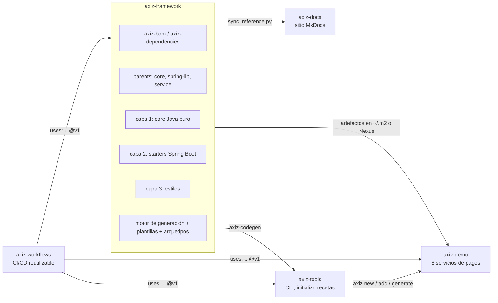
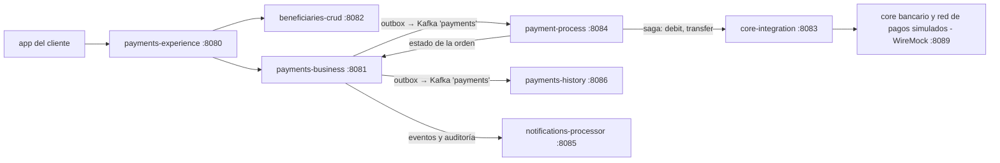

# axiz

axiz es una plataforma backend para construir microservicios bancarios en **Java 25** sobre
**Spring Boot 4.1**, desplegados en **Amazon EKS** y servicios de **AWS**. Reúne en un solo lugar
lo que cada equipo de una entidad financiera necesitaría resolver por su cuenta:

- librerías y starters con las prácticas ya resueltas (seguridad, idempotencia, outbox, inbox,
  sagas, auditoría, cifrado y observabilidad);
- un generador de servicios;
- pipelines de CI/CD;
- un demo de pagos que usa todas las capacidades.

Este documento es la puerta de entrada. Explica qué contiene cada repositorio, cómo se relacionan
y cómo ejecutar y probar el demo desde una máquina sin nada instalado.

## Contenido

1. [Los cinco repositorios](#1-los-cinco-repositorios)
2. [Cómo se relacionan](#2-cómo-se-relacionan)
3. [Requisitos](#3-requisitos)
4. [Ejecutar el demo paso a paso](#4-ejecutar-el-demo-paso-a-paso)
5. [Probar el demo con curl](#5-probar-el-demo-con-curl)
6. [Probar con Bruno](#6-probar-con-bruno)
7. [Detener y limpiar](#7-detener-y-limpiar)
8. [Problemas frecuentes](#8-problemas-frecuentes)
9. [Compilar y probar el framework completo](#9-compilar-y-probar-el-framework-completo)
10. [Crear un servicio propio](#10-crear-un-servicio-propio)
11. [Documentación](#11-documentación)
12. [Revisiones incorporadas](#12-revisiones-incorporadas)

## 1. Los cinco repositorios

Cada carpeta es un repositorio independiente, con su propio pipeline y su propio `README.md`.

| Repositorio | Qué contiene | Lo necesitas para el demo |
|---|---|---|
| [`axiz-framework`](axiz-framework) | BOM de versiones, parents de Maven y las capas del framework (ver abajo). También el motor de generación con sus plantillas y arquetipos, los estándares de calidad y las reglas ArchUnit. | **Sí**: se compila e instala primero |
| [`axiz-tools`](axiz-tools) | CLI `axiz` (crear servicios, agregar capacidades, generar código, sincronizar contratos), `axiz-initializr` (generador web) y recetas de OpenRewrite para actualizar versiones | No (opcional) |
| [`axiz-demo`](axiz-demo) | Procesador de pagos de 8 servicios hecho con axiz, entorno local con Docker Compose, colección Bruno, charts y despliegue en kind | **Sí**: es lo que se ejecuta |
| [`axiz-workflows`](axiz-workflows) | Workflows reutilizables de GitHub Actions (CI de librerías y servicios, publicación por etapas, despliegue GitOps) y políticas de Kyverno | No (solo CI) |

Las capas de `axiz-framework` son tres:

- **Capa 1**: Java puro, sin Spring.
- **Capa 2**: starters de Spring Boot.
- **Capa 3**: estilos de arquitectura (hexagonal, CQRS, capas, EDA y BFF).

## 2. Cómo se relacionan



- **Framework → servicios.** Cada servicio hereda de `pe.axiz:axiz-parent-service` y usa los
  starters `axiz-*-spring-boot-starter`, con versiones gobernadas por `axiz-bom`. Por eso el
  framework se instala antes: el demo resuelve esos artefactos desde `~/.m2`. En una organización
  vendrían del Nexus corporativo.
- **Framework → herramientas.** La CLI y el initializr incluyen el motor `axiz-codegen`. El código
  que generan es idéntico al de CI. Los servicios del demo se crearon con `axiz new` y crecieron
  con `axiz add` y `axiz generate`.
- **Workflows → todos.** Los pipelines de los demás repositorios llaman a los workflows
  reutilizables por la etiqueta `v1` (`lib-publish`, `lib-promote`, `service-ci` y despliegue).
- **Framework → documentación.** `axiz-docs/scripts/sync_reference.py` genera la referencia de
- **Versión.** Todos los repositorios están en `0.1.0-SNAPSHOT`, y el demo usa esa misma versión
  del framework.

Dentro del demo, el flujo de un pago es este:



El octavo servicio, `settlement-batch`, es un job que concilia el archivo diario de la red de pagos.

## 3. Requisitos

En una máquina limpia necesitas:

| Herramienta | Versión | Para qué |
|---|---|---|
| JDK | **25** (por ejemplo Eclipse Temurin 25) | compilar y ejecutar; `java -version` debe decir 25 |
| Docker Engine + Compose v2 | Docker 24+ (`docker compose version`) | infraestructura local del demo |
| `curl`, `jq` | cualquiera reciente | pruebas y scripts del demo |
| `python3` | 3.8+ | solo para decodificar tokens en las pruebas (sección 5) |
| Git | opcional | clonar los repositorios |

No necesitas instalar Maven: cada repositorio trae el wrapper `./mvnw`, que descarga Maven 3.9 y
verifica su checksum. Docker se instala con Docker Desktop (Windows y macOS) o Docker Engine
(Linux), desde <https://docs.docker.com/get-docker/>.

**Recursos.** Necesitas unos 12 GB de RAM libres, porque son 8 contenedores más 7 JVM, y unos
5 GB de disco para dependencias e imágenes. Estos puertos deben estar libres:

- servicios: 8080–8086;
- WireMock: 8089;
- Keycloak: 8180;
- Grafana y OTLP: 3000, 4317 y 4318;
- LocalStack: 4566;
- PostgreSQL: 5432;
- Valkey: 6379;
- Kafka: 9092.

**Windows con WSL2.** Ejecuta todo dentro de WSL, con Docker Desktop y la integración WSL activa.
Copia los repositorios al sistema de archivos de Linux (por ejemplo `~/axiz`) en lugar de
`/mnt/c` o `/mnt/d`. Sobre `/mnt` Maven y la compilación son varias veces más lentos.

```bash
cp -r /mnt/d/ruta/donde/descomprimiste ~/axiz   # ejemplo
cd ~/axiz
```

Para instalar las herramientas en Ubuntu (o WSL Ubuntu):

```bash
sudo apt-get update && sudo apt-get install -y curl jq python3
# JDK 25: https://adoptium.net (paquete temurin-25-jdk) o SDKMAN: sdk install java 25-tem
java -version            # debe mostrar 25
docker compose version   # debe mostrar v2.x
```

## 4. Ejecutar el demo paso a paso

Todos los comandos se ejecutan desde la carpeta raíz que contiene los cinco repositorios.

### 4.1 Compilar e instalar el framework

```bash
cd axiz-framework
./mvnw install -DskipTests
cd ..
```

**Qué hace.** Compila unos 150 módulos y los instala en `~/.m2/repository/pe/axiz`: BOM, parents,
librerías, starters, estilos, motor de generación y estándares. La primera vez descarga las
dependencias y tarda entre 10 y 20 minutos. Las siguientes veces tarda unos pocos minutos.

`-DskipTests` evita correr las pruebas, porque no hacen falta para usar el demo. La sección 9
explica cómo correrlas.

**Qué validar:**

```bash
ls ~/.m2/repository/pe/axiz/axiz-parent-service/0.1.0-SNAPSHOT/   # existe el .pom
ls ~/.m2/repository/pe/axiz/ | wc -l                             # alrededor de 145 artefactos
```

La salida termina con `BUILD SUCCESS`. Si falla, ve a [Problemas frecuentes](#8-problemas-frecuentes).

### 4.2 (Opcional) Herramientas

El demo no necesita la CLI. Si quieres generar servicios propios (sección 10), compílala
después del framework:

```bash
cd axiz-tools
./mvnw -pl axiz-cli -am package -DskipTests
java -jar axiz-cli/target/axiz-cli-*-jar-with-dependencies.jar catalog   # lista arquetipos y capacidades
cd ..
```

### 4.3 Compilar los servicios del demo

```bash
cd axiz-demo
./mvnw package -DskipTests
```

**Qué hace.** Compila los 8 servicios y la verificación de cobertura de capacidades. Este paso es
opcional, porque `demo.sh up` compila cada servicio al arrancarlo. Hacerlo antes evita que 7
compilaciones corran a la vez la primera vez.

**Qué validar:** `BUILD SUCCESS` y un `target/*.jar` en cada carpeta de `services/`.

### 4.4 Levantar la infraestructura y los servicios

Si ya habías levantado el demo con una versión anterior, primero bájalo con sus volúmenes. Así
Keycloak vuelve a importar el realm:

```bash
scripts/demo.sh down
```

Después levántalo:

```bash
scripts/demo.sh up
```

**Qué hace.**

1. `docker compose -f local/compose.yaml up -d --wait` levanta y espera la infraestructura:

   | Contenedor | Qué simula | Puerto |
   |---|---|---|
   | PostgreSQL | Aurora | 5432 |
   | Valkey | ElastiCache | 6379 |
   | Kafka | MSK, con los topics `payments`, `payments.dlq` y `audit` | 9092 |
   | LocalStack | DynamoDB, S3, SQS, SNS, KMS y Secrets Manager | 4566 |
   | Keycloak | proveedor OIDC, realm `axiz` | 8180 |
   | WireMock | core bancario y red de pagos | 8089 |
   | Grafana + OTel | métricas y trazas | 3000 |

2. `scripts/dev-secrets.sh` genera los secretos de desarrollo de cada servicio en
   `services/*/local/secrets`. Son valores aleatorios, salvo el client secret de
   `payment-process`, que coincide con el realm.
3. Arranca los 7 servicios con `./mvnw spring-boot:run` y los perfiles `local,platform`, en
   segundo plano. Cada servicio deja su log en `.run/<servicio>.log`.

El comando termina enseguida, pero los servicios tardan entre 1 y 3 minutos en compilar y
arrancar.

### 4.5 Verificar que todo está arriba

```bash
scripts/demo.sh status
```

**Qué validar.** Repite el comando hasta que muestre:

```text
payments-business         8081  UP
beneficiaries-crud        8082  UP
core-integration          8083  UP
payment-process           8084  UP
notifications-processor   8085  UP
payments-history          8086  UP
payments-experience       8080  UP
7/7 services UP
```

Si un servicio sigue en `DOWN`, revisa su log, por ejemplo con `tail -100 .run/payment-process.log`.

### 4.6 Prueba automática de punta a punta

```bash
scripts/demo.sh smoke
```

**Qué hace.**

1. Obtiene el token de la clienta `ana`.
2. Registra un beneficiario, o reutiliza el que ya existe.
3. Paga por el canal.
4. Espera a que la saga complete la orden.
5. Espera a que el historial (Kafka → R2DBC) refleje el pago.

**Qué validar.** La salida termina así:

```text
beneficiary 0e6c...
payment 0193...: {"paymentId":"0193...","operationNumber":"OP2026...","status":"RECEIVED",...}
status RECEIVED
status PROCESSING
status COMPLETED
history COMPLETED
OK
```

El historial puede mostrar `not projected yet` unas veces antes de `COMPLETED`, porque es
eventualmente consistente.

## 5. Probar el demo con curl

Las pruebas siguen un orden: cada una usa variables de las anteriores. Para cada `curl` se indica
qué debes validar en la respuesta. Ejecútalas en la misma terminal, desde `axiz-demo`.

Todos los errores siguen el mismo formato (RFC 9457):

```json
{"type": "...", "title": "...", "status": 422, "detail": "...", "code": "PAYMENTS-..."}
```

### 5.0 Preparar la terminal

```bash
KC=http://localhost:8180/realms/axiz/protocol/openid-connect/token
EXP=http://localhost:8080      # payments-experience (API del canal)
BUS=http://localhost:8081      # payments-business
CRUD=http://localhost:8082     # beneficiaries-crud
CORE=http://localhost:8083     # core-integration
PROC=http://localhost:8084     # payment-process
HIST=http://localhost:8086     # payments-history

# muestra el cuerpo y el código HTTP
api() { curl -s -w '\nHTTP %{http_code}\n' "$@"; }
# nueva llave de idempotencia
key() { cat /proc/sys/kernel/random/uuid 2>/dev/null || uuidgen; }
# decodifica el payload de un JWT
jwt() { python3 -c 'import sys,json,base64;p=sys.argv[1].split(".")[1];print(json.dumps(json.loads(base64.urlsafe_b64decode(p+"="*(-len(p)%4))),indent=2))' "$1"; }

# usuarios (clientes) del realm: ana = C-1001, luis = C-1002
user_token() { curl -s "$KC" -d grant_type=password -d client_id=payments-web \
  -d username="$1" -d password="local-only-$1" | jq -r .access_token; }
ANA=$(user_token ana)
LUIS=$(user_token luis)
# aplicaciones (client credentials)
M2M=$(curl -s "$KC" -d grant_type=client_credentials -d client_id=payment-process \
  -d client_secret=local-only-payment-process | jq -r .access_token)
OTHER=$(curl -s "$KC" -d grant_type=client_credentials -d client_id=local-client \
  -d client_secret=local-only | jq -r .access_token)
JSON=(-H "Content-Type: application/json")
```

Los tokens duran 15 minutos. Si una prueba responde `401`, vuelve a ejecutar las líneas de los
tokens.

### 5.1 Tokens

```bash
jwt "$ANA" | jq '{sub, azp, preferred_username, aud, scope}'
jwt "$M2M" | jq '{sub, azp, preferred_username, scope}'
```

**Qué validar:**

- En `ANA`:
  - `"sub": "C-1001"`, que es el id de la clienta; los servicios lo usan como dueño de los
    recursos;
  - `"azp": "payments-web"`;
  - `"preferred_username": "ana"`;
  - `aud` incluye `local-services`.
- En `M2M`:
  - `"azp": "payment-process"`;
  - `"preferred_username": "service-account-payment-process"`; esto es lo que marca el token como
    de una aplicación y no de una persona;
  - `scope` incluye `payments:process`.

Si falta `sub` o `preferred_username`, Keycloak conserva un realm anterior. Ejecuta
`scripts/demo.sh down` y `scripts/demo.sh up`.

### 5.2 Salud de los servicios

```bash
for p in 8080 8081 8082 8083 8084 8085 8086; do echo "$p $(curl -s localhost:$p/actuator/health | jq -r .status)"; done
```

**Qué validar:** las 7 líneas dicen `UP`. Solo `health` e `info` son públicos; el resto de
`/actuator` pide token.

### 5.3 Beneficiarios (beneficiaries-crud, DynamoDB)

**Registrar un beneficiario:**

```bash
api -X POST "$CRUD/v1/customers/C-1001/beneficiaries" -H "Authorization: Bearer $ANA" "${JSON[@]}" \
  -H "Idempotency-Key: $(key)" \
  -d '{"alias":"Landlord","holderName":"Ana Torres","cci":"00219100123456789053","currency":"PEN"}'
```

**Qué validar:**

- `HTTP 201`, con un `id` nuevo y `customerId` igual a `C-1001`.
- Si ya ejecutaste `smoke`, responde `HTTP 409` con `code` igual a
  `PAYMENTS-BENEFICIARIESCRUD-0002`, porque el beneficiario ya existe. Es correcto: hay un solo
  beneficiario activo por cuenta.

**Registrar un segundo beneficiario** (la red de pagos rechaza esta cuenta destino por cerrada):

```bash
api -X POST "$CRUD/v1/customers/C-1001/beneficiaries" -H "Authorization: Bearer $ANA" "${JSON[@]}" \
  -H "Idempotency-Key: $(key)" \
  -d '{"alias":"Cuenta cerrada","holderName":"Pedro Ruiz","cci":"00219100123456780052","currency":"PEN"}'
```

**Validar los dígitos de control de un CCI inválido:**

```bash
api -X POST "$CRUD/v1/customers/C-1001/beneficiaries" -H "Authorization: Bearer $ANA" "${JSON[@]}" \
  -H "Idempotency-Key: $(key)" \
  -d '{"alias":"Mal","holderName":"X","cci":"12345678901234567890","currency":"PEN"}'
```

**Qué validar:** `HTTP 422` con `code` igual a `PAYMENTS-BENEFICIARIESCRUD-0001`.

**Guardar los ids:**

```bash
BEN=$(curl -s "$CRUD/v1/customers/C-1001/beneficiaries" -H "Authorization: Bearer $ANA" | jq -r '.items[] | select(.alias=="Landlord") | .id')
CLOSED=$(curl -s "$CRUD/v1/customers/C-1001/beneficiaries" -H "Authorization: Bearer $ANA" | jq -r '.items[] | select(.alias=="Cuenta cerrada") | .id')
echo "BEN=$BEN CLOSED=$CLOSED"
```

**Qué validar:** las dos variables tienen un valor.

**Consultar los beneficiarios por el canal:**

```bash
api "$EXP/v1/beneficiaries?size=20" -H "Authorization: Bearer $ANA"
```

**Qué validar:** `HTTP 200` y, en cada item, `creditorCci` enmascarado, por ejemplo
`"****************9053"`. El canal nunca devuelve la cuenta completa.

### 5.4 Pagar a un beneficiario (camino feliz)

```bash
PAY_KEY=$(key)
PAY_BODY="{\"beneficiaryId\":\"$BEN\",\"debtorAccount\":\"1910012345678\",\"amount\":120.50,\"currency\":\"PEN\",\"description\":\"Alquiler\"}"
api -X POST "$EXP/v1/payments" -H "Authorization: Bearer $ANA" "${JSON[@]}" -H "Idempotency-Key: $PAY_KEY" -d "$PAY_BODY" | tee /tmp/pay.txt
PAY=$(head -1 /tmp/pay.txt | jq -r .paymentId); echo "PAY=$PAY"
```

**Qué validar:**

- `HTTP 201`.
- `status` es `RECEIVED`.
- `operationNumber` tiene la forma `OP<fecha>-<secuencia>`.
- `beneficiaryAlias` es `Landlord`.
- `creditorCci` está enmascarado.
- `processingDate` es hoy, o el siguiente día hábil si pasaron las 18:00 de Lima (hora de corte)
  o si es fin de semana.

Si responde `409` con `PAYMENTS-PAYMENTSEXPERIENCE-0004`, hoy ya existe un pago por el mismo
monto al mismo beneficiario. Cambia `amount`, por ejemplo a `121.50`.

**Seguir el estado:**

```bash
for i in $(seq 1 15); do curl -s "$EXP/v1/payments/$PAY" -H "Authorization: Bearer $ANA" | jq -r .status; sleep 1; done
```

**Qué validar:** el estado pasa de `RECEIVED` a `PROCESSING` y luego a `COMPLETED` en pocos
segundos. Detrás ocurre esto:

1. payments-business publica `payment-order.created` en Kafka mediante el outbox.
2. payment-process ejecuta la saga: `processing`, `debit` en el core vía core-integration,
   `transfer` a la red y `complete`.

**El proceso (saga), visto por una aplicación:**

```bash
api "$PROC/v1/payment-processes/$PAY" -H "Authorization: Bearer $M2M"
```

**Qué validar:** `HTTP 200` con `"status": "COMPLETED"`. Con el token de `ana`, la misma llamada
responde `403`: solo las aplicaciones con `payments:process` o `payments:read` pueden verlo.

**El historial (read model reactivo):**

```bash
api "$HIST/v1/payments/$PAY" -H "Authorization: Bearer $ANA"
api "$HIST/v1/customers/C-1001/payments?page=0&size=5" -H "Authorization: Bearer $ANA"
```

**Qué validar:**

- `HTTP 200`.
- El pago aparece con `status` `COMPLETED`, el mismo `operationNumber`, `customerId` `C-1001` y
  `creditorCci` enmascarado.
- La lista viene ordenada del cambio más reciente al más antiguo.

### 5.5 Idempotencia

**Reintentar exactamente la misma solicitud** (por ejemplo, el cliente perdió la respuesta):

```bash
curl -s -D - -o /tmp/replay.json -X POST "$EXP/v1/payments" -H "Authorization: Bearer $ANA" "${JSON[@]}" \
  -H "Idempotency-Key: $PAY_KEY" -d "$PAY_BODY" | grep -i -E "^HTTP|idempotent"
jq -r .paymentId /tmp/replay.json
```

**Qué validar:**

- `HTTP/1.1 201` y la cabecera `Idempotent-Replayed: true`.
- El `paymentId` es el mismo `$PAY`. No se crea una segunda orden ni se cobra dos veces.

**Misma llave con otro contenido:**

```bash
api -X POST "$EXP/v1/payments" -H "Authorization: Bearer $ANA" "${JSON[@]}" -H "Idempotency-Key: $PAY_KEY" \
  -d "{\"beneficiaryId\":\"$BEN\",\"debtorAccount\":\"1910012345678\",\"amount\":999.00,\"currency\":\"PEN\"}"
```

**Qué validar:** `HTTP 422` con `code` igual a `AXZ-IDEM-0422`.

**Sin llave:**

```bash
api -X POST "$EXP/v1/payments" -H "Authorization: Bearer $ANA" "${JSON[@]}" -d "$PAY_BODY"
```

**Qué validar:** `HTTP 400` con `code` igual a `AXZ-IDEM-0400`.

### 5.6 Rechazos y compensaciones de la saga

En el core simulado, la cuenta `1910099999999` no tiene fondos (`CB-51`) y la cuenta
`1910088888888` está bloqueada (`CB-62`).

**Fondos insuficientes** (falla el débito):

```bash
NOFUNDS=$(curl -s -X POST "$EXP/v1/payments" -H "Authorization: Bearer $ANA" "${JSON[@]}" -H "Idempotency-Key: $(key)" \
  -d "{\"beneficiaryId\":\"$BEN\",\"debtorAccount\":\"1910099999999\",\"amount\":45.10,\"currency\":\"PEN\"}" | jq -r .paymentId)
sleep 5
curl -s "$EXP/v1/payments/$NOFUNDS" -H "Authorization: Bearer $ANA" | jq '{status}'
curl -s "$PROC/v1/payment-processes/$NOFUNDS" -H "Authorization: Bearer $M2M" | jq
curl -s "$HIST/v1/payments/$NOFUNDS" -H "Authorization: Bearer $ANA" | jq '{status, reason}'
```

**Qué validar:**

- La orden termina en `REJECTED`.
- El proceso muestra `"status": "REJECTED"` y `"failedStep": "debit"`.
- El historial tiene `status` `REJECTED` y un `reason`.
- El rechazo libera la reserva del límite diario (sección 5.9).

**Cuenta destino cerrada** (la red rechaza la transferencia después del débito):

```bash
CLOSEDPAY=$(curl -s -X POST "$EXP/v1/payments" -H "Authorization: Bearer $ANA" "${JSON[@]}" -H "Idempotency-Key: $(key)" \
  -d "{\"beneficiaryId\":\"$CLOSED\",\"debtorAccount\":\"1910012345678\",\"amount\":33.30,\"currency\":\"PEN\"}" | jq -r .paymentId)
sleep 5
curl -s "$PROC/v1/payment-processes/$CLOSEDPAY" -H "Authorization: Bearer $M2M" | jq
curl -s localhost:8089/__admin/requests | jq -r '.requests[].request | "\(.method) \(.url)"' | grep -E "debits|reversal|transfers" | head
```

**Qué validar:**

- El proceso termina en `REJECTED` con `"failedStep": "transfer"`.
- En el registro de WireMock aparecen, en orden inverso de tiempo:
  1. el `POST /core/v2/movements/MV-.../reversal`, que es la compensación del débito;
  2. el `POST /api/transfers` rechazado;
  3. el `POST /core/v2/accounts/1910012345678/debits`.

  El dinero debitado se devolvió.

### 5.7 Reglas de negocio del canal

**Pago duplicado:** mismo monto al mismo beneficiario el mismo día, con una llave nueva.

```bash
api -X POST "$EXP/v1/payments" -H "Authorization: Bearer $ANA" "${JSON[@]}" -H "Idempotency-Key: $(key)" -d "$PAY_BODY"
```

**Qué validar:** `HTTP 409` con `code` igual a `PAYMENTS-PAYMENTSEXPERIENCE-0004`.

**Límite diario** (30 000 PEN por cliente y día):

```bash
api -X POST "$EXP/v1/payments" -H "Authorization: Bearer $ANA" "${JSON[@]}" -H "Idempotency-Key: $(key)" \
  -d "{\"beneficiaryId\":\"$BEN\",\"debtorAccount\":\"1910012345678\",\"amount\":30000.01,\"currency\":\"PEN\"}"
```

**Qué validar:** `HTTP 422` con `code` igual a `PAYMENTS-PAYMENTSEXPERIENCE-0003`.

**Moneda distinta a la del beneficiario:**

```bash
api -X POST "$EXP/v1/payments" -H "Authorization: Bearer $ANA" "${JSON[@]}" -H "Idempotency-Key: $(key)" \
  -d "{\"beneficiaryId\":\"$BEN\",\"debtorAccount\":\"1910012345678\",\"amount\":10,\"currency\":\"USD\"}"
```

**Qué validar:** `HTTP 422` con `code` igual a `PAYMENTS-PAYMENTSEXPERIENCE-0001`.

### 5.8 Autorización: cada quien solo accede a lo suyo

**Sin token:**

```bash
api "$EXP/v1/payments/$PAY"
```

**Qué validar:** `HTTP 401` con `code` igual a `AXZ-SEC-0401`.

**Luis intenta ver el pago de Ana** por el canal, en payments-business y en el historial:

```bash
api "$EXP/v1/payments/$PAY" -H "Authorization: Bearer $LUIS"
api "$BUS/v1/payment-orders/$PAY" -H "Authorization: Bearer $LUIS"
api "$HIST/v1/payments/$PAY" -H "Authorization: Bearer $LUIS"
```

**Qué validar:** las tres llamadas responden `HTTP 404`. Un recurso ajeno se reporta como
inexistente, así nadie puede adivinar ids.

**Luis intenta listar los beneficiarios y el historial de Ana:**

```bash
api "$CRUD/v1/customers/C-1001/beneficiaries" -H "Authorization: Bearer $LUIS"
api "$HIST/v1/customers/C-1001/payments" -H "Authorization: Bearer $LUIS"
```

**Qué validar:** las dos llamadas responden `HTTP 403` con `code` igual a `AXZ-SEC-0403`.

**Ana intenta completar su propia orden o mover dinero directamente:**

```bash
api -X POST "$BUS/v1/payment-orders/$PAY/status" -H "Authorization: Bearer $ANA" "${JSON[@]}" \
  -H "Idempotency-Key: $(key)" -d '{"status":"COMPLETED"}'
api -X POST "$CORE/v1/debits" -H "Authorization: Bearer $ANA" "${JSON[@]}" -H "Idempotency-Key: $(key)" \
  -d '{"accountId":"1910012345678","amount":10,"currency":"PEN","holderId":"C-1001","reference":"X"}'
```

**Qué validar:** las dos llamadas responden `HTTP 403`. Solo payment-process (`payments:process`)
cambia estados y mueve dinero.

**Una aplicación sin scopes (`local-client`):**

```bash
api -X POST "$BUS/v1/payment-orders/$PAY/status" -H "Authorization: Bearer $OTHER" "${JSON[@]}" \
  -H "Idempotency-Key: $(key)" -d '{"status":"COMPLETED"}'
```

**Qué validar:** `HTTP 403`.

**Débito de una cuenta de otro titular,** incluso con el token del proceso:

```bash
api -X POST "$CORE/v1/debits" -H "Authorization: Bearer $M2M" "${JSON[@]}" -H "Idempotency-Key: $(key)" \
  -d '{"accountId":"1910012345678","amount":10,"currency":"PEN","holderId":"C-1002","reference":"X"}'
```

**Qué validar:** `HTTP 422` con `code` igual a `PAYMENTS-COREINTEGRATION-0004`. El core verifica
que la cuenta sea del cliente del pago.

**Lectura de una aplicación autorizada:**

```bash
api "$BUS/v1/payment-orders/$PAY" -H "Authorization: Bearer $M2M"
```

**Qué validar:** `HTTP 200`. Las aplicaciones con `payments:process` leen cualquier orden; los
clientes, solo las suyas.

### 5.9 Verificar por dentro

**Base de datos.** Las cuentas se guardan cifradas, el outbox queda publicado y el límite diario
se ve reservado:

```bash
docker compose -f local/compose.yaml exec postgres psql -U app -d payments_business -c \
  "SELECT operation_number, status, left(debtor_account, 12) AS debtor_cifrada, request_key IS NOT NULL AS con_llave FROM payment_order ORDER BY created_at DESC LIMIT 5;"
docker compose -f local/compose.yaml exec postgres psql -U app -d payments_business -c \
  "SELECT status, count(*) FROM axiz_outbox GROUP BY status;"
docker compose -f local/compose.yaml exec postgres psql -U app -d payments_business -c \
  "SELECT * FROM payment_daily_usage;"
docker compose -f local/compose.yaml exec postgres psql -U app -d payment_process -c \
  "SELECT saga_id, status, step_index, error FROM axiz_saga ORDER BY updated_at DESC LIMIT 5;"
```

**Qué validar:**

- `debtor_cifrada` empieza con `axz1:`, porque la cuenta se cifra antes de guardarla.
- Las órdenes creadas por el canal tienen `con_llave = t`.
- En el outbox todo está `PUBLISHED`.
- `reserved` suma solo los pagos que no fueron rechazados.
- Las sagas están en `COMPLETED` o `COMPENSATED`. Ninguna queda en `IN_DOUBT`: ese estado aparece
  solo si el resultado de un débito o una transferencia fue incierto (por ejemplo, un timeout).

**Kafka.** Los eventos de las órdenes:

```bash
docker compose -f local/compose.yaml exec kafka /opt/kafka/bin/kafka-console-consumer.sh \
  --bootstrap-server localhost:9092 --topic payments --from-beginning --max-messages 3 --property print.headers=true
```

**Qué validar:** aparecen eventos CloudEvents (`ce_type`, `ce_source`, `ce_id`) de
`payment-order.created` y `payment-order.status-changed`.

**S3 en LocalStack:**

```bash
docker compose -f local/compose.yaml exec localstack awslocal s3 ls s3://local-bucket --recursive
```

**Qué validar:** aparece el archivo de liquidación de ejemplo
(`in/settlement/NET-SETTLE-SAMPLE.txt`). Cuando notifications-processor archiva eventos de
auditoría, sus objetos también aparecen en este bucket.

**Observabilidad.** Abre <http://localhost:3000>. Si Grafana pide credenciales, usa
`admin` / `admin`. Valida lo siguiente:

- Dashboards *axiz · payments* y *axiz · services*: aparecen los pagos, la tasa de éxito y la
  latencia por servicio.
- *Explore → Tempo*: una traza de `POST /v1/payments` muestra el recorrido por
  payments-experience, beneficiaries-crud y payments-business. Después, por Kafka, continúa en
  payment-process y core-integration.

### 5.10 Liquidación diaria (batch)

```bash
scripts/run.sh settlement-batch
```

**Qué validar:**

- El job termina solo y el log muestra
  `Settlement job for in/settlement/NET-SETTLE-SAMPLE.txt ended COMPLETED`.
- Si lo ejecutas otra vez, muestra `... was already loaded`. La carga es idempotente.

## 6. Probar con Bruno

[`axiz-demo/bruno`](axiz-demo/bruno) tiene una colección con pruebas automáticas para cada
servicio.

1. Abre la carpeta en Bruno y selecciona el ambiente `local`.
2. Define las dos variables secretas: `password` = `local-only-ana` y `clientSecret` =
   `local-only-payment-process`.
3. Ejecuta primero `00 auth` y luego el resto.

Desde la terminal:

```bash
npm install -g @usebruno/cli
cd axiz-demo/bruno && bru run --env local --env-var password=local-only-ana --env-var clientSecret=local-only-payment-process
```

## 7. Detener y limpiar

```bash
cd axiz-demo
scripts/demo.sh down     # detiene los servicios y borra contenedores y volúmenes (datos de prueba)
```

Para volver a empezar desde cero, repite la [sección 4.4](#44-levantar-la-infraestructura-y-los-servicios).
No hace falta reinstalar el framework, salvo que cambies su código.

## 8. Problemas frecuentes

| Síntoma | Causa y solución |
|---|---|
| `'dependencies.dependency.version' for ... is missing` al compilar el framework | Versión no gobernada por el BOM. Está corregido en esta entrega; si aparece otra, la dependencia debe declararse en `platform/axiz-dependencies/pom.xml`. |
| `Could not find artifact pe.axiz:axiz-parent-service:pom:0.1.0-SNAPSHOT` en el demo | No se instaló el framework. Ejecuta la sección 4.1. |
| `Rule ... RequireJavaVersion failed` | El JDK no es 25. Revisa `java -version` y `JAVA_HOME`. |
| Un servicio no llega a `UP` | Revisa `.run/<servicio>.log`. La primera vez puede tardar porque compila; si dice `Address already in use`, libera el puerto. |
| `401` en todas las llamadas | El token venció (15 minutos). Vuelve a obtener los tokens (5.0). |
| `403` donde se espera `200` con el token del proceso | El realm de Keycloak es anterior a esta entrega. Ejecuta `scripts/demo.sh down` y `up`. |
| El smoke falla con `payment rejected` | La cuenta debitada no es `1910012345678` o el core simulado no responde. Revisa WireMock en <http://localhost:8089/__admin/requests>. |
| `409 ... 0004` al pagar | Ya hay un pago igual hoy. Cambia el monto. |
| Todo es muy lento en WSL | Mueve los repositorios de `/mnt/...` a `~/` (sección 3) y dale a Docker Desktop al menos 8 GB. |
| Docker sin memoria (contenedores reiniciando) | Cierra otros contenedores o súbele memoria a Docker. |
| `Permission denied` al ejecutar `./mvnw` o un script | El zip se extrajo desde Windows y se perdió el permiso de ejecución. Ejecuta `find . -name mvnw -o -name '*.sh' \| xargs chmod +x` desde la raíz. |
| `/bin/bash^M: bad interpreter` | Los archivos quedaron con fin de línea de Windows (CRLF). Extrae el zip dentro de WSL (`unzip`) o configura `git config --global core.autocrlf input` antes de clonar. |

## 9. Compilar y probar el framework completo

El build tiene dos niveles:

```bash
cd axiz-framework
./mvnw verify              # build local: compila, aplica las reglas del enforcer y corre las
                           # pruebas unitarias, de contexto Spring y ArchUnit
./mvnw spotless:apply      # formatea el código (google-java-format); ejecútalo antes de subir cambios
./mvnw -Pquality verify    # gate de CI, el mismo que corre en cada PR: agrega revisión de formato,
                           # Checkstyle, Error Prone + NullAway, convergencia de dependencias,
                           # SpotBugs/FindSecBugs, cobertura JaCoCo y PIT
```

- Las pruebas de `quality/axiz-store-integration-tests` levantan PostgreSQL, Valkey y DynamoDB
  (LocalStack) con Testcontainers, así que necesitan Docker.
- En el demo, `./mvnw verify` desde `axiz-demo` corre las pruebas de los 8 servicios y la
  verificación de que el demo usa todas las capacidades del catálogo.
- Cada repositorio tiene un `VERIFICATION.md`. Ahí está lo que se verificó al construir esta
  entrega y lo que corre solo en CI.

## 10. Crear un servicio propio

Con la CLI compilada (sección 4.2):

```bash
alias axiz='java -jar ~/axiz/axiz-tools/axiz-cli/target/axiz-cli-0.1.0-SNAPSHOT-jar-with-dependencies.jar'
axiz catalog                                  # arquetipos, estilos y capacidades
axiz new orders --archetype business --framework hexagonal --persistence aurora \
  -c idempotency -c outbox --openapi orders.yaml
cd orders && ./mvnw verify && axiz local up && ./mvnw spring-boot:run -Dspring-boot.run.profiles=local
```

`orders.yaml` es el contrato OpenAPI 3.1 del servicio. Puedes partir de uno del demo, por ejemplo
`axiz-demo/contracts/payments-business.yaml`.

El servicio generado ya trae:

- parent y starters;
- contrato OpenAPI y controladores;
- pruebas, incluida `ArchitectureTest`;
- chart de Helm por ambiente;
- `compose.yaml` local;
- pipeline que usa `axiz-workflows`.

La guía completa está en `axiz-docs` (*Empezar*).

## 11. Documentación

```bash
cd axiz-docs
pip install -r requirements.txt
mkdocs serve           # http://localhost:8000
```

Secciones principales:

- arquitectura (capas, estilos, configuración y secretos);
- guías por capacidad: seguridad, idempotencia, eventos, sagas, persistencia, datos sensibles y
  pruebas;
- calidad;
- operación: CI/CD, despliegue, perfil operativo y observabilidad;
- migración;
- referencia de cada módulo.

## 12. Revisiones incorporadas

Esta entrega incluye las correcciones de dos revisiones externas. El detalle está en `axiz-docs`:

- **Primera revisión.** Llaves de idempotencia e inbox con dueño y *fencing*. Mensajes ocupados
  que no se confirman. Sagas que compensan lo que ejecutaron. Contratos de stores probados contra
  backends reales. Wrapper de Maven verificado. Generador reproducible.
- **Segunda revisión** (requisitos de entidad financiera):
  - autorización vigente antes de cualquier replay;
  - autorización por recurso en todos los servicios del demo;
  - sagas que no compensan efectos inciertos (`IN_DOUBT`);
  - deduplicación por `source` + `id`;
  - límite diario reservado de forma atómica y llave de solicitud durable;
  - auditoría durable vía outbox;
  - publicación solo después de todos los gates;
  - migración del inbox;
  - stores en memoria prohibidos en ambientes desplegados.
