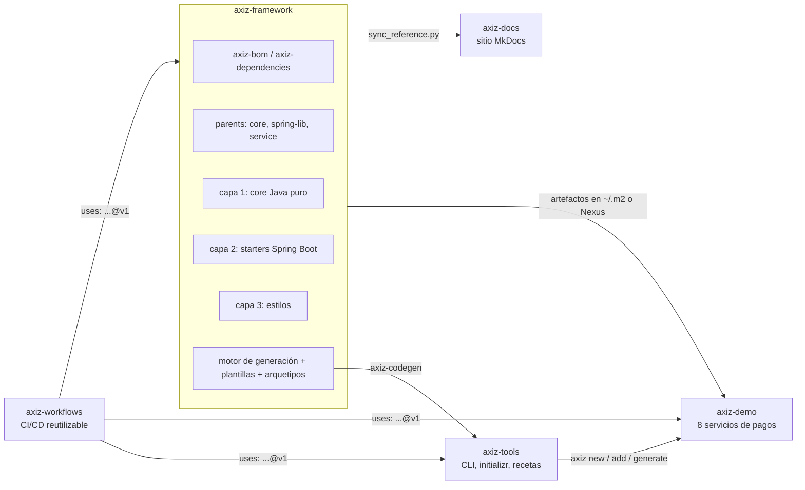
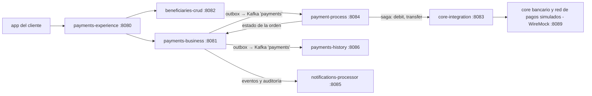

# axiz

axiz es una plataforma backend para construir microservicios bancarios en **Java 25** sobre
**Spring Boot 4.1**, desplegados en **Amazon EKS** y servicios de **AWS**. Reúne en un solo lugar
lo que cada equipo de una entidad financiera necesitaría resolver por su cuenta:

- librerías y starters con las prácticas ya resueltas (seguridad, idempotencia, outbox, inbox,
  sagas, auditoría, cifrado y observabilidad);
- un generador de servicios;
- pipelines de CI/CD;
- un demo de pagos que usa todas las capacidades.

Este documento es la puerta de entrada. Explica qué contiene cada repositorio, cómo se relacionan
y cómo ejecutar y probar el demo desde una máquina sin nada instalado.

## Contenido

1. [Los cinco repositorios](#1-los-cinco-repositorios)
2. [Cómo se relacionan](#2-cómo-se-relacionan)
3. [Requisitos](#3-requisitos)
4. [Ejecutar el demo paso a paso](#4-ejecutar-el-demo-paso-a-paso)
5. [Probar el demo con curl](#5-probar-el-demo-con-curl)
6. [Probar con Bruno](#6-probar-con-bruno)
7. [Detener y limpiar](#7-detener-y-limpiar)
8. [Problemas frecuentes](#8-problemas-frecuentes)
9. [Compilar y probar el framework completo](#9-compilar-y-probar-el-framework-completo)
10. [Crear un servicio propio](#10-crear-un-servicio-propio)
11. [Documentación](#11-documentación)
12. [Revisiones incorporadas](#12-revisiones-incorporadas)

## 1. Los cinco repositorios

Cada carpeta es un repositorio independiente, con su propio pipeline y su propio `README.md`.

| Repositorio | Qué contiene | Lo necesitas para el demo |
|---|---|---|
| [`axiz-framework`](axiz-framework) | BOM de versiones, parents de Maven y las capas del framework (ver abajo). También el motor de generación con sus plantillas y arquetipos, los estándares de calidad y las reglas ArchUnit. | **Sí**: se compila e instala primero |
| [`axiz-tools`](axiz-tools) | CLI `axiz` (crear servicios, agregar capacidades, generar código, sincronizar contratos), `axiz-initializr` (generador web) y recetas de OpenRewrite para actualizar versiones | No (opcional) |
| [`axiz-demo`](axiz-demo) | Procesador de pagos de 8 servicios hecho con axiz, entorno local con Docker Compose, colección Bruno, charts y despliegue en kind | **Sí**: es lo que se ejecuta |
| [`axiz-workflows`](axiz-workflows) | Workflows reutilizables de GitHub Actions (CI de librerías y servicios, publicación por etapas, despliegue GitOps) y políticas de Kyverno | No (solo CI) |

Las capas de `axiz-framework` son tres:

- **Capa 1**: Java puro, sin Spring.
- **Capa 2**: starters de Spring Boot.
- **Capa 3**: estilos de arquitectura (hexagonal, CQRS, capas, EDA y BFF).

## 2. Cómo se relacionan



- **Framework → servicios.** Cada servicio hereda de `pe.axiz:axiz-parent-service` y usa los
  starters `axiz-*-spring-boot-starter`, con versiones gobernadas por `axiz-bom`. Por eso el
  framework se instala antes: el demo resuelve esos artefactos desde `~/.m2`. En una organización
  vendrían del Nexus corporativo.
- **Framework → herramientas.** La CLI y el initializr incluyen el motor `axiz-codegen`. El código
  que generan es idéntico al de CI. Los servicios del demo se crearon con `axiz new` y crecieron
  con `axiz add` y `axiz generate`.
- **Workflows → todos.** Los pipelines de los demás repositorios llaman a los workflows
  reutilizables por la etiqueta `v1` (`lib-publish`, `lib-promote`, `service-ci` y despliegue).
- **Framework → documentación.** `axiz-docs/scripts/sync_reference.py` genera la referencia de
- **Versión.** Todos los repositorios están en `0.1.0-SNAPSHOT`, y el demo usa esa misma versión
  del framework.

Dentro del demo, el flujo de un pago es este:



El octavo servicio, `settlement-batch`, es un job que concilia el archivo diario de la red de pagos.

## 3. Requisitos

En una máquina limpia necesitas:

| Herramienta | Versión | Para qué |
|---|---|---|
| JDK | **25** (por ejemplo Eclipse Temurin 25) | compilar y ejecutar; `java -version` debe decir 25 |
| Docker Engine + Compose v2 | Docker 24+ (`docker compose version`) | infraestructura local del demo |
| `curl`, `jq` | cualquiera reciente | pruebas y scripts del demo |
| `python3` | 3.8+ | solo para decodificar tokens en las pruebas (sección 5) |
| Git | opcional | clonar los repositorios |

No necesitas instalar Maven: cada repositorio trae el wrapper `./mvnw`, que descarga Maven 3.9 y
verifica su checksum. Docker se instala con Docker Desktop (Windows y macOS) o Docker Engine
(Linux), desde <https://docs.docker.com/get-docker/>.

**Recursos.** Necesitas unos 12 GB de RAM libres, porque son 8 contenedores más 7 JVM, y unos
5 GB de disco para dependencias e imágenes. Estos puertos deben estar libres:

- servicios: 8080–8086;
- WireMock: 8089;
- Keycloak: 8180;
- Grafana y OTLP: 3000, 4317 y 4318;
- LocalStack: 4566;
- PostgreSQL: 5432;
- Valkey: 6379;
- Kafka: 9092.

`scripts/demo.sh up` revisa estos puertos antes de arrancar y dice qué contenedor o proceso ocupa
cada uno. El caso más común es un clúster de kind (contenedor `<nombre>-control-plane`) que publica
el 8080. El clúster de kind del propio demo usa 9080, 9180 y 9300, así que puede convivir con el
demo local.

**Windows con WSL2.** Ejecuta todo dentro de WSL, con Docker Desktop y la integración WSL activa.
Copia los repositorios al sistema de archivos de Linux (por ejemplo `~/axiz`) en lugar de
`/mnt/c` o `/mnt/d`. Sobre `/mnt` Maven y la compilación son varias veces más lentos.

```bash
cp -r /mnt/d/ruta/donde/descomprimiste ~/axiz   # ejemplo
cd ~/axiz
```

Para instalar las herramientas en Ubuntu (o WSL Ubuntu):

```bash
sudo apt-get update && sudo apt-get install -y curl jq python3
# JDK 25: https://adoptium.net (paquete temurin-25-jdk) o SDKMAN: sdk install java 25-tem
java -version            # debe mostrar 25
docker compose version   # debe mostrar v2.x
```

## 4. Ejecutar el demo paso a paso

Todos los comandos se ejecutan desde la carpeta raíz que contiene los cinco repositorios.

### 4.1 Compilar e instalar el framework

```bash
cd axiz-framework
./mvnw install -DskipTests
cd ..
```

**Qué hace.** Compila unos 150 módulos y los instala en `~/.m2/repository/pe/axiz`: BOM, parents,
librerías, starters, estilos, motor de generación y estándares. La primera vez descarga las
dependencias y tarda entre 10 y 20 minutos. Las siguientes veces tarda unos pocos minutos.

`-DskipTests` evita correr las pruebas, porque no hacen falta para usar el demo. La sección 9
explica cómo correrlas.

**Qué validar:**

```bash
ls ~/.m2/repository/pe/axiz/axiz-parent-service/0.1.0-SNAPSHOT/   # existe el .pom
ls ~/.m2/repository/pe/axiz/ | wc -l                             # alrededor de 145 artefactos
```

La salida termina con `BUILD SUCCESS`. Si falla, ve a [Problemas frecuentes](#8-problemas-frecuentes).

### 4.2 (Opcional) Herramientas

El demo no necesita la CLI. Si quieres generar servicios propios (sección 10), compílala
después del framework:

```bash
cd axiz-tools
./mvnw -pl axiz-cli -am package -DskipTests
java -jar axiz-cli/target/axiz-cli-*-jar-with-dependencies.jar catalog   # lista arquetipos y capacidades
cd ..
```

### 4.3 Compilar los servicios del demo

```bash
cd axiz-demo
./mvnw clean package -DskipTests
```

**Qué hace.** Compila los 8 servicios y la verificación de cobertura de capacidades, y deja un
jar ejecutable en `services/<servicio>/target`. `demo.sh up` arranca los servicios desde esos
jars. Si falta un jar, o es más antiguo que el código de su servicio, `up` lo vuelve a compilar
(también con `clean`). Por eso este paso es opcional, pero hacerlo aquí muestra cualquier error
de compilación por separado.

`clean` importa: un `package` incremental deja en `target/classes` el `.class` de un archivo que
se renombró o se borró (por ejemplo al extraer una revisión nueva sobre la anterior), y el jar lo
incluye.

**Qué validar:** `BUILD SUCCESS` y un `target/<servicio>-0.1.0-SNAPSHOT.jar` en cada carpeta de
`services/`.

### 4.4 Levantar la infraestructura y los servicios

Si ya habías levantado el demo con una versión anterior, primero bájalo con sus volúmenes. Así
Keycloak vuelve a importar el realm:

```bash
scripts/demo.sh down
```

Después levántalo:

```bash
scripts/demo.sh up
```

**Qué hace.**

1. Verifica los requisitos y se detiene con un mensaje claro si algo falta (después de levantar la
   infraestructura, verifica además que existan los topics de Kafka):
   - Docker está corriendo;
   - el JDK es 25;
   - `curl` y `jq` están instalados;
   - los puertos de la sección 3 están libres. Si uno está ocupado, dice qué contenedor o proceso
     lo tiene y cómo liberarlo.
2. Compila los jars que falten o estén desactualizados: más antiguos que el código del servicio o
   que el framework instalado en `~/.m2`. Así, después de reinstalar el framework, `up` recompila
   los servicios sin que tengas que pedirlo. `--build` los recompila todos. También compila el job
   `settlement-batch`, que no queda corriendo: lo ejecutan las pruebas funcionales (sección 4.7).
3. `docker compose -f local/compose.yaml up -d --wait` levanta y espera la infraestructura:

   | Contenedor | Qué simula | Puerto |
   |---|---|---|
   | PostgreSQL | Aurora | 5432 |
   | Valkey | ElastiCache | 6379 |
   | Kafka | MSK, con los topics `payments`, `payments.dlq` y `audit` | 9092 |
   | LocalStack | DynamoDB, S3, SQS, SNS, KMS y Secrets Manager | 4566 |
   | Keycloak | proveedor OIDC, realm `axiz` | 8180 |
   | WireMock | core bancario y red de pagos | 8089 |
   | Grafana + OTel | métricas y trazas | 3000 |

4. `scripts/dev-secrets.sh` genera los secretos de desarrollo de cada servicio en
   `services/*/local/secrets`. Son valores aleatorios, salvo el client secret de
   `payment-process`, que coincide con el realm.
5. Arranca los 7 servicios en segundo plano (`java -jar` con los perfiles `local,platform`). Cada
   servicio deja su log en `.run/<servicio>.log`.
6. Espera a que los 7 respondan `UP` en `/actuator/health`. Suele tardar entre 30 segundos y
   2 minutos. Si un servicio se cae al arrancar, se detiene y muestra las últimas líneas de su log.
   Si pasan 5 minutos (`AXIZ_UP_TIMEOUT`, en segundos), muestra el estado de cada servicio.

**Qué validar.** La salida termina con:

```text
  7/7 UP after 64s
all services UP
next: scripts/demo.sh smoke
```

Con `scripts/demo.sh up --no-wait` el comando termina apenas arranca los procesos. En ese caso usa
`scripts/demo.sh wait` antes del smoke.

**Ver los logs en la terminal.** Con `scripts/demo.sh up --attach` el comando se queda en la terminal
mostrando los logs de los 7 servicios, cada línea con el nombre del servicio en color, como
`docker compose up`. Avisa cuando los 7 están `UP`, y `Ctrl+C` detiene los servicios (la
infraestructura sigue arriba). El smoke se ejecuta en otra terminal.

Otros comandos útiles:

| Comando | Qué hace |
|---|---|
| `scripts/demo.sh logs` | sigue los logs de todos los servicios; `Ctrl+C` deja de seguirlos, los servicios siguen corriendo |
| `scripts/demo.sh logs payment-process` | sigue el log de un servicio |
| `scripts/demo.sh restart payments-experience --debug` | reinicia un servicio con los logs de Spring web y de axiz en DEBUG |
| `scripts/demo.sh stop` | detiene los servicios y deja la infraestructura |

Los servicios del demo registran en DEBUG el motivo de cada request rechazada (4xx, logger
`axiz.errors`), así el log explica un 404 o un 400.

Si `up` se detiene porque el puerto 8080 está ocupado por un clúster de kind, verás algo así:

```text
port 8080 (payments-experience) is taken by: axiz-control-plane (container, image kindest/node:v1.36.4)
axiz-control-plane is the node of the kind cluster 'axiz'. Stop it while you use the local demo:
  docker stop axiz-control-plane        (docker start axiz-control-plane brings it back)
```

Detén ese contenedor (o borra el clúster con `kind delete cluster --name axiz`) y vuelve a
ejecutar `scripts/demo.sh up`.

### 4.5 Verificar que todo está arriba

```bash
scripts/demo.sh status
```

**Qué validar.** Debe mostrar:

```text
payments-business         8081  UP
beneficiaries-crud        8082  UP
core-integration          8083  UP
payment-process           8084  UP
notifications-processor   8085  UP
payments-history          8086  UP
payments-experience       8080  UP
7/7 services UP
```

Cada servicio aparece en uno de estos estados:

| Estado | Significado | Qué hacer |
|---|---|---|
| `UP` | listo | nada |
| `STARTING` | el proceso vive pero todavía no responde | esperar (`scripts/demo.sh wait`) |
| `DOWN` u `OUT_OF_SERVICE` | responde, pero una dependencia (base de datos, Kafka...) falla | revisar el log y `docker compose -f local/compose.yaml ps` |
| `EXITED` | el proceso terminó | `tail -50 .run/<servicio>.log` |
| `BUSY` | otro programa ocupa el puerto | liberar el puerto; el mensaje dice quién lo tiene |
| `STOPPED` | no está corriendo | `scripts/demo.sh up` |

Para seguir el log de un servicio: `scripts/demo.sh logs payment-process`.

### 4.6 Prueba automática de punta a punta

```bash
scripts/demo.sh smoke
```

**Qué hace.**

0. Espera a que los 7 servicios estén `UP` (hasta 5 minutos, `SMOKE_WAIT` en segundos). Si no lo
   logran, muestra el estado de cada uno y termina con error.
1. Obtiene el token de la clienta `ana`.
2. Registra un beneficiario, o reutiliza el que ya existe.
3. Paga por el canal.
4. Espera a que la saga complete la orden.
5. Espera a que el historial (Kafka → R2DBC) refleje el pago.

**Qué validar.** La salida termina así:

```text
== token of the customer ana (Keycloak http://localhost:8180)
token ok (1432 chars)

== beneficiary of C-1001 (beneficiaries-crud http://localhost:8082)
registered 0e6c...                (o "reusing 0e6c..." desde la segunda ejecución)

== payment through the channel API (payments-experience http://localhost:8080)
payment 0193...: {"paymentId":"0193...","operationNumber":"OP2026...","status":"RECEIVED",...}

== saga: waiting for COMPLETED
status PROCESSING
status COMPLETED

== history read model (payments-history http://localhost:8086)
history COMPLETED

OK: payment 0193... completed and projected
```

El historial puede mostrar `not projected yet` unas veces antes de `COMPLETED`, porque es
eventualmente consistente.

Si un paso falla, el smoke termina con `FAILED:`, el paso, el código HTTP y el cuerpo de la
respuesta (o, si no hubo respuesta, el motivo). Antes muestra las últimas advertencias y errores
de los servicios que participan en ese paso, tomados de `.run/<servicio>.log`. Por ejemplo:

```text
FAILED: token request: no answer: connection refused: nothing listens on http://localhost:8180/...
FAILED: create payment: HTTP 403
{ "title": "Forbidden", ... }
```

La sección [8](#8-problemas-frecuentes) explica las causas más comunes.

### 4.7 Pruebas funcionales completas

El smoke prueba un pago exitoso. Estas pruebas recorren todo lo que el demo promete: rechazos y
compensaciones, reglas del canal, idempotencia, seguridad, eventos, notificaciones, auditoría,
observabilidad, el batch, la cola de errores de Kafka y la recuperación de sagas.

**Antes de la primera ejecución** con esta versión, baja y levanta el demo una vez. Keycloak debe
importar el realm nuevo (los tokens traen el claim `tenant`) y LocalStack debe crear la cola que
recibe una copia de las notificaciones:

```bash
scripts/demo.sh down
scripts/demo.sh up
```

Después:

```bash
scripts/demo.sh scenarios
```

**Qué hace.** Ejecuta 14 grupos en este orden. Cada verificación imprime `PASS` o `FAIL`:

| Grupo | Qué prueba |
|---|---|
| `beneficiaries` | registro, dígitos de control del CCI, un beneficiario activo por cuenta, renombrar (caché invalidada), borrado lógico y nuevo registro, idempotencia sobre DynamoDB, paginación por cursor, enmascaramiento en el canal |
| `payment` | un pago de punta a punta: canal, saga `COMPLETED`, vista del proceso (solo aplicaciones), historial (Kafka → R2DBC), orden en payments-business |
| `idempotency` | reintento con la misma llave (`Idempotent-Replayed: true`, mismo pago), misma llave con otro cuerpo (`AXZ-IDEM-0422`), sin llave (400) |
| `rules` | pago duplicado (`-0004`), límite diario (`-0003`), pagos en USD apagados por feature flag (`-0002`, mensaje en español y en inglés), moneda distinta a la del beneficiario (`-0001`) |
| `saga` | sin fondos y cuenta bloqueada (falla `debit`), cuenta destino cerrada (falla `transfer` y el débito se revierte en el core), luis paga desde la cuenta de ana (el core rechaza al titular); el rechazo devuelve el monto al límite diario y el historial muestra el motivo |
| `security` | 401 sin token o con token inválido, recursos de otro cliente (404 o 403), cambios de estado y movimientos de dinero reservados a payment-process, actuator protegido |
| `integration` | core-integration directo: titular distinto (`-0004`), crédito por SOAP con WS-Security, reverso de un movimiento inexistente (404), transferencia rechazada por la red (`-0003`) |
| `events` | outbox publicado, cuentas cifradas en la base (`axz1:`), sagas de la corrida en `COMPLETED` o `COMPENSATED`, los 3 grupos de consumidores de Kafka conectados y al día, nada en `payments.dlq`, eventos CloudEvents |
| `notifications` | notifications-processor publica en SNS la notificación del pago completado y la del rechazado |
| `audit` | la auditoría de core-integration llega por SQS y se archiva en S3 con su manifiesto; la de payments-business llega al topic `audit`; la DLQ de auditoría está vacía |
| `observability` | métricas de negocio y HTTP en Prometheus; trazas por su ID (tomado de los logs): payment-process y core-integration en la misma traza, y una sola traza desde la request del canal hasta la saga (payments-experience, payments-business, payment-process, core-integration), con la escritura en el outbox y su publicación |
| `settlement` | `settlement-batch` carga el archivo de ejemplo (3 líneas, totales de control), una segunda ejecución no carga nada (idempotente) y deja el resumen en S3 |
| `dlq` | un mensaje malformado en `payments` termina en `payments.dlq` una vez por consumidor, y los consumidores siguen procesando |
| `recovery` | un débito que tarda más que el timeout deja la saga en `VERIFYING` sin compensar; cuando el core vuelve a responder, el job de recuperación la completa |

Tarda unos 8 minutos; `recovery` toma unos 4, porque el job retoma las sagas inactivas por más de
2 minutos. Para ejecutar solo algunos grupos, o saltar alguno:

```bash
scripts/demo.sh scenarios saga security
SCENARIOS_SKIP="recovery" scripts/demo.sh scenarios
```

Cada grupo crea los datos que necesita (beneficiarios, un pago), así que puede ejecutarse solo.
Las pruebas se pueden repetir: reutilizan los beneficiarios y usan montos distintos en cada pago.

**Qué validar.** La salida termina así:

```text
== recovery
       payment 0193...: its debit times out in the core (12 s answer, 4 s read timeout)
  PASS uncertain debit: the process waits VERIFYING, nothing compensated
  PASS   ... the order stays PROCESSING
       the core answers again; the recovery job resumes sagas idle for 2 minutes (every 60 s)...
  PASS the recovery job verifies the debit and completes the payment (151 s)
  PASS   ... the order is COMPLETED
  PASS   ... payment-process logged the resumption

87 checks passed, 0 failed (473 s)
OK: every scenario passed
```

Una verificación que falla muestra el motivo (código HTTP y cuerpo, o el valor encontrado) y las
últimas advertencias y errores de los servicios del grupo. Al final aparece la lista de fallas y el
comando termina con código 1. Por ejemplo:

```text
  FAIL closed destination account (NET-R02): REJECTED, failed step transfer, compensated
         response does not satisfy: .failedStep == "transfer"
         {"processId":"0193...","status":"NEEDS_ATTENTION","failedStep":"transfer"}
         -- last warnings/errors of payment-process (.run/payment-process.log)
           ... WARN ... Saga payment 0193... failed at step transfer: ...
```

Las pruebas leen la infraestructura local (PostgreSQL, Kafka, LocalStack, WireMock y Grafana), así
que solo funcionan con `scripts/demo.sh up`, no contra kind.

## 5. Probar el demo con curl

Las pruebas siguen un orden: cada una usa variables de las anteriores. Para cada `curl` se indica
qué debes validar en la respuesta. Ejecútalas en la misma terminal, desde `axiz-demo`.

Todos los errores siguen el mismo formato (RFC 9457):

```json
{"type": "...", "title": "...", "status": 422, "detail": "...", "code": "PAYMENTS-..."}
```

### 5.0 Preparar la terminal

```bash
KC=http://localhost:8180/realms/axiz/protocol/openid-connect/token
EXP=http://localhost:8080      # payments-experience (API del canal)
BUS=http://localhost:8081      # payments-business
CRUD=http://localhost:8082     # beneficiaries-crud
CORE=http://localhost:8083     # core-integration
PROC=http://localhost:8084     # payment-process
HIST=http://localhost:8086     # payments-history

# muestra el cuerpo y el código HTTP
api() { curl -s -w '\nHTTP %{http_code}\n' "$@"; }
# nueva llave de idempotencia
key() { cat /proc/sys/kernel/random/uuid 2>/dev/null || uuidgen; }
# decodifica el payload de un JWT
jwt() { python3 -c 'import sys,json,base64;p=sys.argv[1].split(".")[1];print(json.dumps(json.loads(base64.urlsafe_b64decode(p+"="*(-len(p)%4))),indent=2))' "$1"; }

# usuarios (clientes) del realm: ana = C-1001, luis = C-1002
user_token() { curl -s "$KC" -d grant_type=password -d client_id=payments-web \
  -d username="$1" -d password="local-only-$1" | jq -r .access_token; }
ANA=$(user_token ana)
LUIS=$(user_token luis)
# aplicaciones (client credentials)
M2M=$(curl -s "$KC" -d grant_type=client_credentials -d client_id=payment-process \
  -d client_secret=local-only-payment-process | jq -r .access_token)
OTHER=$(curl -s "$KC" -d grant_type=client_credentials -d client_id=local-client \
  -d client_secret=local-only | jq -r .access_token)
JSON=(-H "Content-Type: application/json")
```

Los tokens duran 15 minutos. Si una prueba responde `401`, vuelve a ejecutar las líneas de los
tokens.

### 5.1 Tokens

```bash
jwt "$ANA" | jq '{sub, azp, preferred_username, aud, scope, tenant}'
jwt "$M2M" | jq '{sub, azp, preferred_username, scope, tenant}'
```

**Qué validar:**

- En `ANA`:
  - `"sub": "C-1001"`, que es el id de la clienta; los servicios lo usan como dueño de los
    recursos;
  - `"azp": "payments-web"`;
  - `"preferred_username": "ana"`;
  - `aud` incluye `local-services`.
- En los dos, `"tenant": "demo"`. payment-process es multi-tenant y rechaza con `400` una request
  sin tenant.
- En `M2M`:
  - `"azp": "payment-process"`;
  - `"preferred_username": "service-account-payment-process"`; esto es lo que marca el token como
    de una aplicación y no de una persona;
  - `scope` incluye `payments:process`.

Si falta `sub`, `preferred_username` o `tenant`, Keycloak conserva un realm anterior. Ejecuta
`scripts/demo.sh down` y `scripts/demo.sh up`.

### 5.2 Salud de los servicios

```bash
for p in 8080 8081 8082 8083 8084 8085 8086; do echo "$p $(curl -s localhost:$p/actuator/health | jq -r .status)"; done
```

**Qué validar:** las 7 líneas dicen `UP`. Solo `health` e `info` son públicos; el resto de
`/actuator` pide token.

### 5.3 Beneficiarios (beneficiaries-crud, DynamoDB)

**Registrar un beneficiario:**

```bash
api -X POST "$CRUD/v1/customers/C-1001/beneficiaries" -H "Authorization: Bearer $ANA" "${JSON[@]}" \
  -H "Idempotency-Key: $(key)" \
  -d '{"alias":"Landlord","holderName":"Ana Torres","cci":"00219100123456789053","currency":"PEN"}'
```

**Qué validar:**

- `HTTP 201`, con un `id` nuevo y `customerId` igual a `C-1001`.
- Si ya ejecutaste `smoke`, responde `HTTP 409` con `code` igual a
  `PAYMENTS-BENEFICIARIESCRUD-0002`, porque el beneficiario ya existe. Es correcto: hay un solo
  beneficiario activo por cuenta.

**Registrar un segundo beneficiario** (la red de pagos rechaza esta cuenta destino por cerrada):

```bash
api -X POST "$CRUD/v1/customers/C-1001/beneficiaries" -H "Authorization: Bearer $ANA" "${JSON[@]}" \
  -H "Idempotency-Key: $(key)" \
  -d '{"alias":"Cuenta cerrada","holderName":"Pedro Ruiz","cci":"00219100123456780052","currency":"PEN"}'
```

**Validar los dígitos de control de un CCI inválido:**

```bash
api -X POST "$CRUD/v1/customers/C-1001/beneficiaries" -H "Authorization: Bearer $ANA" "${JSON[@]}" \
  -H "Idempotency-Key: $(key)" \
  -d '{"alias":"Mal","holderName":"X","cci":"12345678901234567890","currency":"PEN"}'
```

**Qué validar:** `HTTP 422` con `code` igual a `PAYMENTS-BENEFICIARIESCRUD-0001`.

**Guardar los ids:**

```bash
BEN=$(curl -s "$CRUD/v1/customers/C-1001/beneficiaries" -H "Authorization: Bearer $ANA" | jq -r '.items[] | select(.alias=="Landlord") | .id')
CLOSED=$(curl -s "$CRUD/v1/customers/C-1001/beneficiaries" -H "Authorization: Bearer $ANA" | jq -r '.items[] | select(.alias=="Cuenta cerrada") | .id')
echo "BEN=$BEN CLOSED=$CLOSED"
```

**Qué validar:** las dos variables tienen un valor.

**Consultar los beneficiarios por el canal:**

```bash
api "$EXP/v1/beneficiaries?size=20" -H "Authorization: Bearer $ANA"
```

**Qué validar:** `HTTP 200` y, en cada item, `creditorCci` enmascarado, por ejemplo
`"****************9053"`. El canal nunca devuelve la cuenta completa.

### 5.4 Pagar a un beneficiario (camino feliz)

```bash
PAY_KEY=$(key)
PAY_BODY="{\"beneficiaryId\":\"$BEN\",\"debtorAccount\":\"1910012345678\",\"amount\":120.50,\"currency\":\"PEN\",\"description\":\"Alquiler\"}"
api -X POST "$EXP/v1/payments" -H "Authorization: Bearer $ANA" "${JSON[@]}" -H "Idempotency-Key: $PAY_KEY" -d "$PAY_BODY" | tee /tmp/pay.txt
PAY=$(head -1 /tmp/pay.txt | jq -r .paymentId); echo "PAY=$PAY"
```

**Qué validar:**

- `HTTP 201`.
- `status` es `RECEIVED`.
- `operationNumber` tiene la forma `OP<fecha>-<secuencia>`.
- `beneficiaryAlias` es `Landlord`.
- `creditorCci` está enmascarado.
- `processingDate` es hoy, o el siguiente día hábil si pasaron las 18:00 de Lima (hora de corte)
  o si es fin de semana.

Si responde `409` con `PAYMENTS-PAYMENTSEXPERIENCE-0004`, hoy ya existe un pago por el mismo
monto al mismo beneficiario. Cambia `amount`, por ejemplo a `121.50`.

**Seguir el estado:**

```bash
for i in $(seq 1 15); do curl -s "$EXP/v1/payments/$PAY" -H "Authorization: Bearer $ANA" | jq -r .status; sleep 1; done
```

**Qué validar:** el estado pasa de `RECEIVED` a `PROCESSING` y luego a `COMPLETED` en pocos
segundos. Detrás ocurre esto:

1. payments-business publica `payment-order.created` en Kafka mediante el outbox.
2. payment-process ejecuta la saga: `processing`, `debit` en el core vía core-integration,
   `transfer` a la red y `complete`.

**El proceso (saga), visto por una aplicación:**

```bash
api "$PROC/v1/payment-processes/$PAY" -H "Authorization: Bearer $M2M"
```

**Qué validar:** `HTTP 200` con `"status": "COMPLETED"`. Con el token de `ana`, la misma llamada
responde `403`: solo las aplicaciones con `payments:process` o `payments:read` pueden verlo.

**El historial (read model reactivo):**

```bash
api "$HIST/v1/payments/$PAY" -H "Authorization: Bearer $ANA"
api "$HIST/v1/customers/C-1001/payments?page=0&size=5" -H "Authorization: Bearer $ANA"
```

**Qué validar:**

- `HTTP 200`.
- El pago aparece con `status` `COMPLETED`, el mismo `operationNumber`, `customerId` `C-1001` y
  `creditorCci` enmascarado.
- La lista viene ordenada del cambio más reciente al más antiguo.

### 5.5 Idempotencia

**Reintentar exactamente la misma solicitud** (por ejemplo, el cliente perdió la respuesta):

```bash
curl -s -D - -o /tmp/replay.json -X POST "$EXP/v1/payments" -H "Authorization: Bearer $ANA" "${JSON[@]}" \
  -H "Idempotency-Key: $PAY_KEY" -d "$PAY_BODY" | grep -i -E "^HTTP|idempotent"
jq -r .paymentId /tmp/replay.json
```

**Qué validar:**

- `HTTP/1.1 201` y la cabecera `Idempotent-Replayed: true`.
- El `paymentId` es el mismo `$PAY`. No se crea una segunda orden ni se cobra dos veces.

**Misma llave con otro contenido:**

```bash
api -X POST "$EXP/v1/payments" -H "Authorization: Bearer $ANA" "${JSON[@]}" -H "Idempotency-Key: $PAY_KEY" \
  -d "{\"beneficiaryId\":\"$BEN\",\"debtorAccount\":\"1910012345678\",\"amount\":999.00,\"currency\":\"PEN\"}"
```

**Qué validar:** `HTTP 422` con `code` igual a `AXZ-IDEM-0422`.

**Sin llave:**

```bash
api -X POST "$EXP/v1/payments" -H "Authorization: Bearer $ANA" "${JSON[@]}" -d "$PAY_BODY"
```

**Qué validar:** `HTTP 400` con `code` igual a `AXZ-IDEM-0400`.

### 5.6 Rechazos y compensaciones de la saga

En el core simulado, la cuenta `1910099999999` no tiene fondos (`CB-51`) y la cuenta
`1910088888888` está bloqueada (`CB-62`).

**Fondos insuficientes** (falla el débito):

```bash
NOFUNDS=$(curl -s -X POST "$EXP/v1/payments" -H "Authorization: Bearer $ANA" "${JSON[@]}" -H "Idempotency-Key: $(key)" \
  -d "{\"beneficiaryId\":\"$BEN\",\"debtorAccount\":\"1910099999999\",\"amount\":45.10,\"currency\":\"PEN\"}" | jq -r .paymentId)
sleep 5
curl -s "$EXP/v1/payments/$NOFUNDS" -H "Authorization: Bearer $ANA" | jq '{status}'
curl -s "$PROC/v1/payment-processes/$NOFUNDS" -H "Authorization: Bearer $M2M" | jq
curl -s "$HIST/v1/payments/$NOFUNDS" -H "Authorization: Bearer $ANA" | jq '{status, reason}'
```

**Qué validar:**

- La orden termina en `REJECTED`.
- El proceso muestra `"status": "REJECTED"` y `"failedStep": "debit"`.
- El historial tiene `status` `REJECTED` y un `reason`.
- El rechazo libera la reserva del límite diario (sección 5.9).

**Cuenta destino cerrada** (la red rechaza la transferencia después del débito):

```bash
CLOSEDPAY=$(curl -s -X POST "$EXP/v1/payments" -H "Authorization: Bearer $ANA" "${JSON[@]}" -H "Idempotency-Key: $(key)" \
  -d "{\"beneficiaryId\":\"$CLOSED\",\"debtorAccount\":\"1910012345678\",\"amount\":33.30,\"currency\":\"PEN\"}" | jq -r .paymentId)
sleep 5
curl -s "$PROC/v1/payment-processes/$CLOSEDPAY" -H "Authorization: Bearer $M2M" | jq
curl -s localhost:8089/__admin/requests | jq -r '.requests[].request | "\(.method) \(.url)"' | grep -E "debits|reversal|transfers" | head
```

**Qué validar:**

- El proceso termina en `REJECTED` con `"failedStep": "transfer"`.
- En el registro de WireMock aparecen, en orden inverso de tiempo:
  1. el `POST /core/v2/movements/MV-.../reversal`, que es la compensación del débito;
  2. el `POST /api/transfers` rechazado;
  3. el `POST /core/v2/accounts/1910012345678/debits`.

  El dinero debitado se devolvió.

### 5.7 Reglas de negocio del canal

**Pago duplicado:** mismo monto al mismo beneficiario el mismo día, con una llave nueva.

```bash
api -X POST "$EXP/v1/payments" -H "Authorization: Bearer $ANA" "${JSON[@]}" -H "Idempotency-Key: $(key)" -d "$PAY_BODY"
```

**Qué validar:** `HTTP 409` con `code` igual a `PAYMENTS-PAYMENTSEXPERIENCE-0004`.

**Límite diario** (30 000 PEN por cliente y día):

```bash
api -X POST "$EXP/v1/payments" -H "Authorization: Bearer $ANA" "${JSON[@]}" -H "Idempotency-Key: $(key)" \
  -d "{\"beneficiaryId\":\"$BEN\",\"debtorAccount\":\"1910012345678\",\"amount\":30000.01,\"currency\":\"PEN\"}"
```

**Qué validar:** `HTTP 422` con `code` igual a `PAYMENTS-PAYMENTSEXPERIENCE-0003`.

**Pagos en dólares** (apagados por el feature flag `payments-usd`):

```bash
api -X POST "$EXP/v1/payments" -H "Authorization: Bearer $ANA" "${JSON[@]}" -H "Idempotency-Key: $(key)" \
  -H "Accept-Language: en" \
  -d "{\"beneficiaryId\":\"$BEN\",\"debtorAccount\":\"1910012345678\",\"amount\":10,\"currency\":\"USD\"}"
```

**Qué validar:** `HTTP 422` con `code` igual a `PAYMENTS-PAYMENTSEXPERIENCE-0002` y `detail`
`Payments in USD are not available.` Sin `Accept-Language`, el mensaje sale en español (`es-PE`).
El canal rechaza la moneda antes de mirar el beneficiario. Con `AXIZ_FLAG_PAYMENTS_USD=true` en el
entorno de payments-experience, los pagos en USD se aceptan.

**Moneda distinta a la del beneficiario:** registra un beneficiario en dólares y págale en soles.

```bash
USDBEN=$(curl -s -X POST "$CRUD/v1/customers/C-1001/beneficiaries" -H "Authorization: Bearer $ANA" "${JSON[@]}" \
  -H "Idempotency-Key: $(key)" \
  -d '{"alias":"Dolares","holderName":"Ana Torres","cci":"00219100123456781159","currency":"USD"}' | jq -r .id)
api -X POST "$EXP/v1/payments" -H "Authorization: Bearer $ANA" "${JSON[@]}" -H "Idempotency-Key: $(key)" \
  -d "{\"beneficiaryId\":\"$USDBEN\",\"debtorAccount\":\"1910012345678\",\"amount\":10,\"currency\":\"PEN\"}"
```

**Qué validar:** `HTTP 422` con `code` igual a `PAYMENTS-PAYMENTSEXPERIENCE-0001`. Si el
beneficiario ya existía, `USDBEN` queda vacío; tómalo de la lista de beneficiarios.

### 5.8 Autorización: cada quien solo accede a lo suyo

**Sin token:**

```bash
api "$EXP/v1/payments/$PAY"
```

**Qué validar:** `HTTP 401` con `code` igual a `AXZ-SEC-0401`.

**Luis intenta ver el pago de Ana** por el canal, en payments-business y en el historial:

```bash
api "$EXP/v1/payments/$PAY" -H "Authorization: Bearer $LUIS"
api "$BUS/v1/payment-orders/$PAY" -H "Authorization: Bearer $LUIS"
api "$HIST/v1/payments/$PAY" -H "Authorization: Bearer $LUIS"
```

**Qué validar:** las tres llamadas responden `HTTP 404`. Un recurso ajeno se reporta como
inexistente, así nadie puede adivinar ids.

**Luis intenta listar los beneficiarios y el historial de Ana:**

```bash
api "$CRUD/v1/customers/C-1001/beneficiaries" -H "Authorization: Bearer $LUIS"
api "$HIST/v1/customers/C-1001/payments" -H "Authorization: Bearer $LUIS"
```

**Qué validar:** las dos llamadas responden `HTTP 403` con `code` igual a `AXZ-SEC-0403`.

**Ana intenta completar su propia orden o mover dinero directamente:**

```bash
api -X POST "$BUS/v1/payment-orders/$PAY/status" -H "Authorization: Bearer $ANA" "${JSON[@]}" \
  -H "Idempotency-Key: $(key)" -d '{"status":"COMPLETED"}'
api -X POST "$CORE/v1/debits" -H "Authorization: Bearer $ANA" "${JSON[@]}" -H "Idempotency-Key: $(key)" \
  -d '{"accountId":"1910012345678","amount":10,"currency":"PEN","holderId":"C-1001","reference":"X"}'
```

**Qué validar:** las dos llamadas responden `HTTP 403`. Solo payment-process (`payments:process`)
cambia estados y mueve dinero.

**Una aplicación sin scopes (`local-client`):**

```bash
api -X POST "$BUS/v1/payment-orders/$PAY/status" -H "Authorization: Bearer $OTHER" "${JSON[@]}" \
  -H "Idempotency-Key: $(key)" -d '{"status":"COMPLETED"}'
```

**Qué validar:** `HTTP 403`.

**Débito de una cuenta de otro titular,** incluso con el token del proceso:

```bash
api -X POST "$CORE/v1/debits" -H "Authorization: Bearer $M2M" "${JSON[@]}" -H "Idempotency-Key: $(key)" \
  -d '{"accountId":"1910012345678","amount":10,"currency":"PEN","holderId":"C-1002","reference":"X"}'
```

**Qué validar:** `HTTP 422` con `code` igual a `PAYMENTS-COREINTEGRATION-0004`. El core verifica
que la cuenta sea del cliente del pago.

**Lectura de una aplicación autorizada:**

```bash
api "$BUS/v1/payment-orders/$PAY" -H "Authorization: Bearer $M2M"
```

**Qué validar:** `HTTP 200`. Las aplicaciones con `payments:process` leen cualquier orden; los
clientes, solo las suyas.

### 5.9 Verificar por dentro

**Base de datos.** Las cuentas se guardan cifradas, el outbox queda publicado y el límite diario
se ve reservado:

```bash
docker compose -f local/compose.yaml exec postgres psql -U app -d payments_business -c \
  "SELECT operation_number, status, left(debtor_account, 12) AS debtor_cifrada, request_key IS NOT NULL AS con_llave FROM payment_order ORDER BY created_at DESC LIMIT 5;"
docker compose -f local/compose.yaml exec postgres psql -U app -d payments_business -c \
  "SELECT status, count(*) FROM axiz_outbox GROUP BY status;"
docker compose -f local/compose.yaml exec postgres psql -U app -d payments_business -c \
  "SELECT * FROM payment_daily_usage;"
docker compose -f local/compose.yaml exec postgres psql -U app -d payment_process -c \
  "SELECT saga_id, status, step_index, error FROM axiz_saga ORDER BY updated_at DESC LIMIT 5;"
```

**Qué validar:**

- `debtor_cifrada` empieza con `axz1:`, porque la cuenta se cifra antes de guardarla.
- Las órdenes creadas por el canal tienen `con_llave = t`.
- En el outbox todo está `PUBLISHED`.
- `reserved` suma solo los pagos que no fueron rechazados.
- Las sagas están en `COMPLETED` o `COMPENSATED`. Ninguna queda en `IN_DOUBT`: ese estado aparece
  solo si el resultado de un débito o una transferencia fue incierto (por ejemplo, un timeout).

**Kafka.** Los eventos de las órdenes:

```bash
docker compose -f local/compose.yaml exec kafka /opt/kafka/bin/kafka-console-consumer.sh \
  --bootstrap-server localhost:9092 --topic payments --from-beginning --max-messages 3 --property print.headers=true
```

**Qué validar:** aparecen eventos CloudEvents (`ce_type`, `ce_source`, `ce_id`) de
`payment-order.created` y `payment-order.status-changed`.

**S3 en LocalStack:**

```bash
docker compose -f local/compose.yaml exec localstack awslocal s3 ls s3://local-bucket --recursive
```

**Qué validar:** aparece el archivo de liquidación de ejemplo
(`in/settlement/NET-SETTLE-SAMPLE.txt`). Cuando notifications-processor archiva eventos de
auditoría, sus objetos también aparecen en este bucket.

**Observabilidad.** Abre <http://localhost:3000>. Si Grafana pide credenciales, usa
`admin` / `admin`. Valida lo siguiente:

- Dashboards *axiz · payments* y *axiz · services*: aparecen los pagos, la tasa de éxito y la
  latencia por servicio.
- *Explore → Tempo*: una sola traza de `POST /v1/payments` muestra todo el pago:
  payments-experience, beneficiaries-crud y payments-business; el `outbox write payments` de la
  orden; el `outbox dispatch payments` cuando el relay la publica; y, por Kafka, payment-process
  (la saga), core-integration, payments-history y notifications-processor. Busca con TraceQL
  `{resource.service.name="payments-experience"} && {resource.service.name="core-integration"}`.
- Cada línea de log lleva `[traceId-spanId]`, y la de cada request de entrada (`axiz.http`) muestra
  el `traceparent` que mandó el llamador: con eso se ve en qué salto se corta una traza.

### 5.10 Liquidación diaria (batch)

```bash
scripts/run.sh settlement-batch
```

**Qué validar:**

- El job termina solo y el log muestra
  `Settlement job for in/settlement/NET-SETTLE-SAMPLE.txt ended COMPLETED`.
- Si lo ejecutas otra vez, muestra `... was already loaded`. La carga es idempotente.

## 6. Probar con Bruno

[`axiz-demo/bruno`](axiz-demo/bruno) tiene una colección con pruebas automáticas para cada
servicio.

1. Abre la carpeta en Bruno y selecciona el ambiente `local`.
2. Define las dos variables secretas: `password` = `local-only-ana` y `clientSecret` =
   `local-only-payment-process`.
3. Ejecuta primero `00 auth` y luego el resto.

Desde la terminal:

```bash
npm install -g @usebruno/cli
cd axiz-demo/bruno && bru run --env local --env-var password=local-only-ana --env-var clientSecret=local-only-payment-process
```

## 7. Detener y limpiar

```bash
cd axiz-demo
scripts/demo.sh down     # detiene los servicios y borra contenedores y volúmenes (datos de prueba)
```

Para volver a empezar desde cero, repite la [sección 4.4](#44-levantar-la-infraestructura-y-los-servicios).
No hace falta reinstalar el framework, salvo que cambies su código.

## 8. Problemas frecuentes

| Síntoma | Causa y solución |
|---|---|
| `'dependencies.dependency.version' for ... is missing` al compilar el framework | Versión no gobernada por el BOM. Está corregido en esta entrega; si aparece otra, la dependencia debe declararse en `platform/axiz-dependencies/pom.xml`. |
| `Could not find artifact pe.axiz:axiz-parent-service:pom:0.1.0-SNAPSHOT` en el demo | No se instaló el framework. Ejecuta la sección 4.1. |
| `Rule ... RequireJavaVersion failed` | El JDK no es 25. Revisa `java -version` y `JAVA_HOME`. |
| `failed to connect to the docker API at unix:///var/run/docker.sock` o `Docker is not running` | Docker no está iniciado. Abre Docker Desktop (con la integración WSL activa) o, en WSL sin Docker Desktop, ejecuta `sudo service docker start`. |
| `port 8080 (payments-experience) is taken by: <nombre>-control-plane` | Un clúster de kind publica el 8080. Detén su nodo con `docker stop <nombre>-control-plane` (lo recuperas con `docker start`) o bórralo con `kind delete cluster --name <nombre>`. |
| `port ... is taken by: a process outside Docker` | Otro programa usa el puerto. `sudo ss -ltnp 'sport = :<puerto>'` muestra cuál. |
| `scripts/demo.sh smoke` no muestra nada | Era la versión anterior del script, que fallaba en silencio si los servicios aún no arrancaban. La actual espera a los servicios y explica cada fallo. |
| `scripts/demo.sh scenarios` termina con `the tokens have no claim "tenant"` | Keycloak conserva el realm anterior a review19. `scripts/demo.sh down` y `scripts/demo.sh up`. |
| El grupo `notifications` falla con `probe queue ... missing` | LocalStack se inicializó con un demo anterior a review19, que no creaba la cola que copia las notificaciones. `scripts/demo.sh down` y `scripts/demo.sh up`. |
| `GET /v1/payment-processes/...` responde `400` con `tenant is required` | El token no trae el claim `tenant` (realm anterior a review19). `scripts/demo.sh down` y `scripts/demo.sh up`. |
| El grupo `settlement` falla con `settlement-batch jar missing` | El jar del batch no se compiló. `scripts/demo.sh up` lo compila; también `./mvnw clean package -DskipTests -pl services/settlement-batch -am`. |
| `payments-experience` muestra `NoClassDefFoundError: jakarta/servlet/ServletException` y el pago no responde | El framework instalado es anterior a review13. Reinstala el framework (sección 4.1), luego `scripts/demo.sh down` y `scripts/demo.sh up`. |
| El pago responde `404` con `AXZ-CORE-0404` y el log de payments-experience dice `NoResourceFoundException` | El framework instalado es anterior a review14: con el header `API-Version` opcional y sin versión por defecto, WebFlux no encontraba ninguna ruta. Reinstala el framework (sección 4.1), luego `scripts/demo.sh down` y `scripts/demo.sh up`. |
| El pago queda en `RECEIVED`, sin errores, y `.run/payment-process.log` no tiene `ConsumerConfig values` | El framework instalado es anterior a review17: con `axiz.messaging.kafka.topics` escrito como lista YAML no se creaba ningún consumidor, y payment-process nunca leía el evento. El smoke lo detecta y muestra el grupo de consumidores. Reinstala el framework (sección 4.1), luego `scripts/demo.sh down` y `scripts/demo.sh up`. |
| El pago queda en `RECEIVED` y payments-business dice `INVALID_TOPIC_EXCEPTION` para `kafka:payments` | El framework instalado es anterior a review16: el publicador de Kafka usaba `kafka:payments` como nombre de topic en vez de `payments`. Reinstala el framework (sección 4.1), luego `scripts/demo.sh down` y `scripts/demo.sh up`. |
| El pago queda en `RECEIVED` y payments-business repite `UNKNOWN_TOPIC_OR_PARTITION` | Los topics de Kafka no se crearon (demo anterior a review15: el broker solo se anunciaba como `localhost` y el job `kafka-topics` no podía conectarse). Con review15, `scripts/demo.sh down` y `scripts/demo.sh up`; `up` verifica que existan `payments`, `payments.dlq` y `audit`. |
| El smoke falla con `no answer: ...` | El texto que sigue dice qué pasó: `connection refused` (el servicio no escucha), `no response in 30s` (no respondió a tiempo) o `closed the connection` (cerró la conexión). Encima, el smoke muestra las últimas advertencias y errores de los servicios que participan en ese paso. Con eso puedes revisar el log completo en `.run/<servicio>.log`. |
| `payments-business` termina con `Schema validation: wrong column type encountered in column [currency]` | Es el demo de review10 o anterior: la migración creaba `currency` como `CHAR(3)` y la entidad la valida como `VARCHAR(3)`. Con review11, la migración `V4__currency_varchar.sql` la corrige. Ejecuta `scripts/demo.sh down` y `scripts/demo.sh up`. |
| `notifications-processor` termina con `At least one trusted issuer is required` | El framework instalado es anterior a review10: el starter de EDA incluía el resource server de seguridad, y un procesador de eventos no configura emisores. Reinstala el framework (sección 4.1), luego `scripts/demo.sh down` y `scripts/demo.sh up`. |
| `beneficiaries-crud` o `notifications-processor` terminan con `Failed to configure a DataSource` | El framework instalado es anterior a review9: sus starters layered y EDA traían un pool de conexiones. Reinstala el framework (sección 4.1) y ejecuta `scripts/demo.sh down` y `scripts/demo.sh up`. |
| Al arrancar cada servicio aparece `WARNING: sun.misc.Unsafe::arrayBaseOffset has been called by com.google.protobuf.UnsafeUtil` | El framework instalado es anterior a review21 (`protobuf-java` 4.35, que trae la exportación de métricas OTLP). Reinstala el framework (sección 4.1) y vuelve a compilar el demo: `scripts/demo.sh down` y `scripts/demo.sh up --build`. |
| El grupo `rules` falla porque el pago en USD responde `201` | Demo anterior a review21: el perfil `platform` encendía el flag `payments-usd` por encima de `AXIZ_FLAG_PAYMENTS_USD`. Con review21, `scripts/demo.sh down` y `scripts/demo.sh up --build`. |
| `core-integration` registra `SqsException: The security token included in the request is invalid` y el grupo `audit` falla | El framework instalado es anterior a review21: el cliente SQS de la auditoría ignoraba `axiz.aws.endpoint` y salía a AWS real. Reinstala el framework (sección 4.1), luego `scripts/demo.sh down` y `scripts/demo.sh up --build`. |
| `settlement-batch` termina con `The bean 'settlementJob' ... could not be registered` | La clase de configuración y su `@Bean` se llamaban igual (antes de review21), o el jar todavía lleva el `SettlementJob.class` de esa versión: la clase se renombró a `SettlementJobConfiguration` y un `package` sin `clean` dejó el `.class` anterior en `target/classes` (el log muestra `SettlementJob.class` dentro del jar). Desde review23 `demo.sh` compila con `clean package`; ejecuta `scripts/demo.sh up --build`. La regla `UNIQUE_BEAN_NAMES` del `ArchitectureTest` detecta los nombres repetidos al ejecutar las pruebas. |
| `scenarios` falla en `audit of core-integration archived on S3 (SQS -> S3)` aunque el objeto existe | Antes de review23 el escenario contaba con `--query KeyCount`: el AWS CLI pagina `list-objects-v2`, une las páginas y `KeyCount` sale `None`. Ahora cuenta `length(Contents)`. |
| Falla `one trace from the channel request to the saga` | El mensaje dice qué servicios tiene la traza de la última orden. Si falta `payments-experience`, el demo es anterior a review21 (sin `spring-boot-starter-webclient` las llamadas del canal salían sin `traceparent`). Si falla `core-integration continues the trace of payment-process`, compara el `traceparent` de la línea `axiz.http` de core-integration que muestra el mensaje con el trace ID de payment-process. |
| `scripts/demo.sh up` termina con `the Kafka topics were not created` aunque el log del job muestra `Created topic payments.` | Versión de review21 o anterior: el script esperaba el job con `docker compose wait`, que en algunas versiones de Compose falla con un job que ya terminó. Desde review22 pregunta al broker por los topics. Reemplaza `axiz-demo/scripts/demo.sh` y vuelve a ejecutar `scripts/demo.sh up --build`. |
| `scripts/demo.sh up --build` termina enseguida sin mostrar nada y luego `smoke` espera 300 s con todo `STOPPED` | Versión de review23 o anterior en una copia nueva (sin carpetas `target/`, por ejemplo al extraer el zip en otra carpeta): el script buscaba el jar en `target/`, la búsqueda fallaba y `set -e` lo cerraba sin mensaje. Desde review24 compila los jars que faltan, cualquier falla inesperada de los scripts muestra la línea y el comando, y `wait`/`smoke` fallan de inmediato si un servicio no se arrancó. |
| `payments-experience` o `payments-history` muestran `WARNING: java.lang.System::loadLibrary has been called by io.netty.util.internal.NativeLibraryUtil` | El framework instalado es anterior a review23: el jar no declaraba `Enable-Native-Access`. Reinstala el framework (sección 4.1), luego `scripts/demo.sh down` y `scripts/demo.sh up --build`. |
| `core-integration` registra `ERROR ... status=503 code=AXZ-EXT-0502 ... failed with status -1` con un stack trace largo durante el grupo `recovery` | Es el timeout simulado del core (esperado), registrado con el framework anterior a review23. Con review23 sale una línea `WARN ... status=504 code=AXZ-EXT-0504 ... got no response (SocketTimeoutException) cause=...` sin stack trace. |
| `<servicio> stopped while starting` o estado `EXITED` | El servicio se cayó al arrancar. El mensaje muestra el final de su log; el log completo está en `.run/<servicio>.log`. |
| Un servicio sigue en `STARTING` después de 5 minutos | La máquina está saturada. Revisa memoria (sección 3) y `.run/<servicio>.log`. |
| `401` en todas las llamadas | El token venció (15 minutos). Vuelve a obtener los tokens (5.0). |
| `403` donde se espera `200` con el token del proceso | El realm de Keycloak es anterior a esta entrega. Ejecuta `scripts/demo.sh down` y `up`. |
| El smoke falla con `payment rejected` | La cuenta debitada no es `1910012345678` o el core simulado no responde. Revisa WireMock en <http://localhost:8089/__admin/requests>. |
| `409 ... 0004` al pagar | Ya hay un pago igual hoy. Cambia el monto. |
| Todo es muy lento en WSL | Mueve los repositorios de `/mnt/...` a `~/` (sección 3) y dale a Docker Desktop al menos 8 GB. |
| Docker sin memoria (contenedores reiniciando) | Cierra otros contenedores o súbele memoria a Docker. |
| `Permission denied` al ejecutar `./mvnw` o un script | El zip se extrajo desde Windows y se perdió el permiso de ejecución. Ejecuta `find . -name mvnw -o -name '*.sh' \| xargs chmod +x` desde la raíz. |
| `/bin/bash^M: bad interpreter` | Los archivos quedaron con fin de línea de Windows (CRLF). Extrae el zip dentro de WSL (`unzip`) o configura `git config --global core.autocrlf input` antes de clonar. |

## 9. Compilar y probar el framework completo

El build tiene dos niveles:

```bash
cd axiz-framework
./mvnw verify              # build local: compila, aplica las reglas del enforcer y corre las
                           # pruebas unitarias, de contexto Spring y ArchUnit
./mvnw spotless:apply      # formatea el código (google-java-format); ejecútalo antes de subir cambios
./mvnw -Pquality verify    # gate de CI, el mismo que corre en cada PR: agrega revisión de formato,
                           # Checkstyle, Error Prone + NullAway, convergencia de dependencias,
                           # SpotBugs/FindSecBugs, cobertura JaCoCo y PIT
```

- Las pruebas de `quality/axiz-store-integration-tests` levantan PostgreSQL, Valkey y DynamoDB
  (LocalStack) con Testcontainers, así que necesitan Docker.
- En el demo, `./mvnw verify` desde `axiz-demo` corre las pruebas de los 8 servicios y la
  verificación de que el demo usa todas las capacidades del catálogo.
- Cada repositorio tiene un `VERIFICATION.md`. Ahí está lo que se verificó al construir esta
  entrega y lo que corre solo en CI.

## 10. Crear un servicio propio

Con la CLI compilada (sección 4.2):

```bash
alias axiz='java -jar ~/axiz/axiz-tools/axiz-cli/target/axiz-cli-0.1.0-SNAPSHOT-jar-with-dependencies.jar'
axiz catalog                                  # arquetipos, estilos y capacidades
axiz new orders --archetype business --framework hexagonal --persistence aurora \
  -c idempotency -c outbox --openapi orders.yaml
cd orders && ./mvnw verify && axiz local up && ./mvnw spring-boot:run -Dspring-boot.run.profiles=local
```

`orders.yaml` es el contrato OpenAPI 3.1 del servicio. Puedes partir de uno del demo, por ejemplo
`axiz-demo/contracts/payments-business.yaml`.

El servicio generado ya trae:

- parent y starters;
- contrato OpenAPI y controladores;
- pruebas, incluida `ArchitectureTest`;
- chart de Helm por ambiente;
- `compose.yaml` local;
- pipeline que usa `axiz-workflows`.

La guía completa está en `axiz-docs` (*Empezar*).

## 11. Documentación

```bash
cd axiz-docs
pip install -r requirements.txt
mkdocs serve           # http://localhost:8000
```

Secciones principales:

- arquitectura (capas, estilos, configuración y secretos);
- guías por capacidad: seguridad, idempotencia, eventos, sagas, persistencia, datos sensibles y
  pruebas;
- calidad;
- operación: CI/CD, despliegue, perfil operativo y observabilidad;
- migración;
- referencia de cada módulo.

## 12. Revisiones incorporadas

Esta entrega incluye las correcciones de dos revisiones externas. El detalle está en `axiz-docs`:

- **Primera revisión.** Llaves de idempotencia e inbox con dueño y *fencing*. Mensajes ocupados
  que no se confirman. Sagas que compensan lo que ejecutaron. Contratos de stores probados contra
  backends reales. Wrapper de Maven verificado. Generador reproducible.
- **Segunda revisión** (requisitos de entidad financiera):
  - autorización vigente antes de cualquier replay;
  - autorización por recurso en todos los servicios del demo;
  - sagas que no compensan efectos inciertos (`IN_DOUBT`);
  - deduplicación por `source` + `id`;
  - límite diario reservado de forma atómica y llave de solicitud durable;
  - auditoría durable vía outbox;
  - publicación solo después de todos los gates;
  - migración del inbox;
  - stores en memoria prohibidos en ambientes desplegados.
- **Arranque y smoke del demo:**
  - `demo.sh up` revisa Docker, el JDK y los puertos antes de arrancar, y nombra a quien ocupa un
    puerto;
  - los servicios arrancan desde sus jars y `up` espera a que los 7 estén `UP`;
  - `smoke` espera a los servicios y muestra el código HTTP y la respuesta de cualquier paso que
    falle;
  - el clúster de kind del demo usa los puertos 9080, 9180 y 9300 para convivir con el demo
    local.
- **Persistencia de los starters de estilo:** el starter layered ya no trae JPA y el de EDA ya no
  trae un pool JDBC. Con ese pool, un servicio sobre DynamoDB no arrancaba
  (`beneficiaries-crud`: `Failed to configure a DataSource`). Una regla de
  `check-dependency-governance.py` impide que vuelva a pasar.
- **Seguridad del estilo EDA:** el starter de EDA ya no incluye el resource server, porque un
  procesador de eventos no tiene API ni emisores de tokens que configurar
  (`notifications-processor`: `At least one trusted issuer is required`). Si la lista de emisores
  queda vacía en un servicio con API, el error indica qué configurar.
- **Esquema de payments-business:** `currency` pasa de `CHAR(3)` a `VARCHAR(3)` con validación de
  formato ISO 4217, en una migración nueva (`V4`). Hibernate valida el esquema al arrancar y
  rechazaba la columna `CHAR`. Todas las migraciones del demo y de los proyectos generados se
  aplicaron sobre PostgreSQL real, y las consultas SQL del framework y del demo se prepararon
  contra esos esquemas.
- **Token relay en servicios reactivos:** un cliente HTTP reactivo con `auth.type: TOKEN_RELAY`
  (payments-experience hacia beneficiaries-crud y payments-business) buscaba el token en el
  contexto de seguridad del hilo, que en WebFlux está vacío. Ahora lo toma del contexto de
  Reactor. El smoke explica además por qué no hubo respuesta y muestra los errores de los
  servicios involucrados.
- **Errores en servicios reactivos:** el traductor de excepciones del framework usaba una clase
  que depende del API de servlets, ausente en WebFlux. Cualquier error en payments-experience
  hacía fallar el propio manejador de errores y la request quedaba sin respuesta (el smoke
  esperaba 30 s). Ahora esas clases solo se cargan en servicios servlet, un traductor que falle
  ya no impide responder, y las fallas de red de los clientes reactivos (timeout, conexión
  rechazada) se responden como error de dependencia (503), igual que en servlet.
- **Versión de API por defecto:** en un servicio reactivo con versionado por header opcional y sin
  versión por defecto, Spring WebFlux no encuentra ninguna ruta para una request sin el header y
  responde 404 (era el error del pago). El framework usa ahora la versión por defecto configurada
  o, si falta, la menor soportada, y falla al arrancar si no puede elegir ninguna. El arquetipo
  experience y payments-experience la declaran (`default-version: '1'`).
- **Logs del demo:** `scripts/demo.sh up --attach` muestra los logs de todos los servicios en la
  terminal; `logs`, `restart --debug` y `stop` completan el ciclo, y el smoke muestra las llamadas
  fallidas además de los errores.
- **Kafka del demo:** el broker anuncia dos direcciones, `kafka:29092` para los contenedores y
  `localhost:9092` para los servicios. Con una sola, el job que crea los topics no podía
  conectarse, faltaban `payments` y `audit` y la saga del pago nunca empezaba. `demo.sh up` ahora
  verifica los topics antes de arrancar los servicios.
- **Idempotencia reactiva:** el registro de la respuesta se guarda como parte de escribirla. Antes
  se hacía después, y el servidor podía cancelar ese trabajo al terminar la respuesta
  (`RedisCommandInterruptedException`), dejando la llave en curso hasta que venciera.
- **Destinos de Kafka:** `axiz.messaging.destinations` documenta el formato `kafka:<topic>`, pero
  el publicador de Kafka enviaba a un topic llamado literalmente `kafka:payments`, que Kafka
  rechaza. Los eventos de la orden nunca salían del outbox y la saga no empezaba. El publicador
  ahora quita el prefijo (prueba ejecutada con el `MockProducer` de Kafka).
- **Idempotencia reactiva (segunda parte):** la respuesta se registra en un worker independiente
  de la request. Cuando el cliente cierra la conexión apenas recibe la respuesta, el servidor
  cancela el trabajo de esa request; el registro ya no depende de ella y no se interrumpe.
- **Consumidores de Kafka:** la condición que crea los listeners leía `axiz.messaging.kafka.topics`
  como un texto; escrita como lista YAML (como en todos los servicios) parecía vacía y ningún
  servicio consumía. El evento quedaba en el topic y el pago en `RECEIVED`. Ahora la lista se lee
  con el binder de Spring Boot (prueba ejecutada con las tres formas de escribirla). Lo mismo
  aplicaba a las colas SQS de `notifications-processor`.
- **Datos sensibles en eventos:** el enmascaramiento de `@Sensitive` estaba en el `JsonMapper` de
  la aplicación, que también arma el payload de los eventos. La cuenta a debitar viajaba como
  `*********5678` y el débito habría fallado en el siguiente paso de la saga. Ahora solo se
  enmascaran las respuestas HTTP (ejecutado con Jackson 3: el evento conserva la cuenta y la
  respuesta la enmascara).
- **Tipos sin handler:** el topic `payments` lleva `created` y `status-changed`.
  `payment-process` y `notifications-processor` procesan uno solo y mandaban el otro a la DLQ;
  ahora lo confirman sin procesarlo (`ignore-unknown-types: true`).
- **Advertencias del build:** `axiz-featureflags-spring-boot-autoconfigure` declara
  `spotbugs-annotations` como `provided`. Las clases del SDK de OpenFeature traen
  `@SuppressFBWarnings`, y sin la anotación en el classpath javac avisaba una vez por cada miembro
  anotado. Los starters (solo dependencias), los módulos que solo tienen pruebas y el reporte de
  cobertura ya no avisan `JAR will be empty`: los primeros crean el jar a propósito
  (`maven.jar.forceCreation`) y el reporte de cobertura usa packaging `pom`.
- **Pruebas funcionales (`scripts/demo.sh scenarios`):** 85 verificaciones en 14 grupos cubren lo que
  el smoke no toca (sección 4.7). Al escribirlas se encontraron tres problemas del demo:
  - la vista del proceso (`GET /v1/payment-processes/{id}`) respondía `400`, porque payment-process
    es multi-tenant y los tokens no traían tenant. El realm ahora agrega el claim `tenant`;
  - la sección 5.7 y Bruno esperaban `-0001` para un pago en USD, pero el feature flag lo rechaza
    antes con `-0002`. Se corrigieron, y el caso de moneda distinta ahora usa un beneficiario en
    dólares;
  - la sección 5.9 decía que la traza del pago continuaba por Kafka. La saga tiene su propia traza,
    que empieza en la publicación del outbox.
  LocalStack crea además una cola suscrita al topic de notificaciones, para verificar lo que se
  envía, y `demo.sh up` compila el job `settlement-batch`.
- **Trazas completas a través del outbox:** la request que registra un pago y su saga son ahora una
  sola traza. Antes el outbox publicaba el evento fuera de la request, y la saga empezaba una traza
  nueva. El `OutboxWriter` guarda con el evento el contexto de la escritura
  (`outboxtraceparent`); el relay lo continúa al publicar (span `outbox dispatch`) y lo quita antes
  de enviar al broker; Kafka lleva el `traceparent` de la publicación a los consumidores. Aplica a
  todo lo que pasa por el outbox, también la auditoría durable y las reacciones de EDA. Probado con
  los handlers reales de Micrometer Tracing: request → `outbox write` → `outbox dispatch` →
  `publish` → handler del consumidor, todo en la misma traza. El grupo `observability` de los
  escenarios lo verifica en Tempo.
- **Advertencias de arranque y fallas de los escenarios (review21):**
  - `protobuf-java` 4.36.2 en `axiz-dependencies`. La exportación de métricas OTLP lo trae y, hasta
    la 4.35, su runtime llamaba a métodos de `sun.misc.Unsafe` marcados para eliminación: Java 25
    lo avisaba al arrancar cada servicio. La 4.36 (protobuf v36, agosto de 2026) ya no los usa en
    el runtime completo; se revisó en sus fuentes que ninguna clase de ese camino llega a
    `UnsafeUtil`. No se ocultó con `--sun-misc-unsafe-memory-access`.
  - Clientes AWS: la auditoría por SQS, KMS, Secrets Manager, Parameter Store y los stores en
    DynamoDB creaban su cliente sin endpoint ni región cuando no había un bean. Desde local iban a
    AWS real (`403` en la auditoría de core-integration, sin archivo en S3). Ahora todos usan
    `AwsClients.configured(...)` (`axiz.aws.<servicio>.endpoint` o `axiz.aws.endpoint`), observados
    y cerrados al apagar; prueba ejecutada con un `SqsClient` real.
  - `settlement-batch` no arrancaba: la clase `SettlementJob` y su `@Bean settlementJob()` daban el
    mismo nombre de bean. La clase es ahora `SettlementJobConfiguration`, y la nueva regla
    `UNIQUE_BEAN_NAMES` de ArchUnit (en el `ArchitectureTest` de todo servicio) detecta ese error.
    Ejecutada sobre los 27 servicios generados, encontró el mismo problema en el generador:
    `axiz generate command x` y `axiz generate query x` creaban dos `XHandler` en paquetes
    distintos. Ahora son `XCommandHandler` y `XQueryHandler`.
    Además el adaptador de S3 trae ahora la librería con la que se construye su cliente: sin ella
    el batch habría fallado después con `NoClassDefFoundError`.
  - Pagos en USD: el perfil `platform` de payments-experience encendía el flag por encima de
    `AXIZ_FLAG_PAYMENTS_USD`. Se quitó; el flag está apagado en local y encendido en kind.
  - Trazas: las llamadas de `WebClient` del canal salían sin observación (en Boot 4 el soporte de
    `WebClient` es `spring-boot-starter-webclient`, que el demo no tenía), así que la traza se
    cortaba entre payments-experience y payments-business. Los clientes de `axiz.http-client`
    reciben ahora el `ObservationRegistry` en los dos stacks (con `RestClient` se ejecutó en un
    contexto de Spring Boot con un servidor HTTP: el `traceparent` llega con la traza del
    llamador; `WebClient` no se pudo ejecutar aquí, sin Reactor Netty), los servicios
    reactivos generados declaran ese starter y el demo también. El endpoint de trazas usaba la
    propiedad de Boot 3 (`management.otlp.tracing.endpoint`, ignorada en Boot 4); en kind las
    trazas no salían. Las verificaciones de trazas de los escenarios toman el trace ID de los logs
    y lo buscan en Tempo, y si fallan dicen en qué salto se cortó.
  - Logs: los stores en memoria (solo permitidos en `local` y `test`) informan en INFO; los 409 se
    registran en INFO; Lettuce ya no avisa `Connection is already closed` al apagar (la conexión
    la cierra el cliente Redis); las notificaciones registran el medio en un tag propio
    (`medium`) en vez de `channel`, que es el canal del cliente.
- **Fallas de los escenarios y logs (review23):**
  - `settlement`: el jar del batch todavía llevaba el `SettlementJob.class` anterior al cambio de
    nombre. `package` sin `clean` no borra de `target/classes` las clases cuyo fuente se renombró
    o se borró. `demo.sh` compila ahora con `clean package` y también detecta archivos borrados
    (la fecha de su carpeta cambia).
  - `audit ... archived on S3`: el objeto existía, pero el AWS CLI pagina `list-objects-v2` y, al
    unir las páginas, `--query KeyCount` devuelve `None`. El escenario cuenta `length(Contents)`.
  - Dependencia que no contesta: un timeout se respondía 503 con el mensaje
    `failed with status -1` y se registraba en ERROR con ~190 líneas de stack trace por intento.
    Ahora un timeout es 504 (`AXZ-EXT-0504`, como ya hacían el cliente SOAP y la BFF), una
    conexión rechazada sigue en 503, el mensaje dice `got no response (SocketTimeoutException)` y
    el cliente HTTP conserva la causa. Las fallas de dependencias se registran en WARN con
    `cause=<tipo>: <mensaje>` y sin stack trace; las fallas internas siguen en ERROR con él
    (detalle en `axiz-docs`, guía de errores). Para la saga, 503 y 504 siguen siendo un resultado
    incierto (`IN_DOUBT`).
  - `WARNING: A restricted method in java.lang.System has been called` en los servicios
    reactivos: Netty carga su transporte nativo con `System.loadLibrary`, que desde Java 24 exige
    acceso nativo y que una versión futura bloqueará. `axiz-parent-service` lo concede de forma
    explícita (JEP 472): atributo `Enable-Native-Access: ALL-UNNAMED` en el manifiesto del jar
    ejecutable, `--enable-native-access=ALL-UNNAMED` en la imagen de Jib (que no arranca con
    `java -jar`) y en las pruebas.
- **Scripts del demo en una copia nueva (review24):** `scripts/demo.sh up` terminaba sin mensaje
  cuando aún no existía ninguna carpeta `target/`: la búsqueda del jar fallaba y `set -e` cerraba el
  script. Ahora compila los jars que faltan. `demo.sh`, `smoke.sh`, `dev-secrets.sh` y `run.sh`
  usan `set -E` con un `trap ERR` que muestra la línea y el comando de cualquier falla inesperada,
  y `scripts/demo.sh wait` (y por lo tanto `smoke`) falla de inmediato si un servicio no se
  arrancó, en vez de esperar 300 s.

