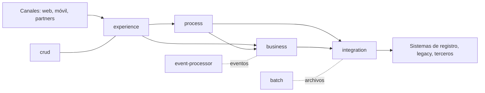

# Arquetipos

Un arquetipo es el **rol** del servicio en el ecosistema. Define qué estilos, stacks y
persistencias admite, qué capacidades trae siempre, si expone REST (y entonces exige contrato) y
cómo se despliega. El [catálogo](catalogo.md) tiene el detalle generado desde el código.

Las dependencias entre servicios solo bajan: `experience → process → business → integration`;
nunca suben ni saltan al canal. Los eventos permiten reaccionar sin acoplar.

| Arquetipo | Cuándo | Estilos | Despliegue |
|---|---|---|---|
| `experience` | API de un canal: adapta y agrega, no tiene dominio | bff | Deployment |
| `business` | dueño de un dominio y sus datos | hexagonal, cqrs, layered | Deployment |
| `process` | procesos largos entre dominios (sagas) | hexagonal, cqrs | Deployment |
| `integration` | capa anticorrupción frente a core, legacy y terceros | hexagonal, cqrs | Deployment |
| `event-processor` | reacciona a eventos, sin API pública | eda | Deployment |
| `batch` | archivos y conciliaciones | batch | CronJob |
| `crud` | tablas de mantenimiento y catálogos simples | layered | Deployment |
| `library` | librería Java pura para el ecosistema | – | Nexus |
| `starter` | capacidad nueva (librería + starter de Spring Boot) | – | Nexus |

## Cómo elegir

- ¿Hay reglas de negocio y datos propios? **business** (hexagonal; cqrs si lecturas y escrituras
  tienen cargas o modelos distintos; layered solo si el dominio es casi inexistente).
- ¿Coordina varios dominios con pasos que se deben deshacer? **process** con una saga.
- ¿Habla con un sistema que no controlas? **integration**: traduce su modelo y sus errores al
  vuestro y aísla credenciales, timeouts y reintentos.
- ¿Lo usa directamente una app o un partner? **experience** (BFF): compone, adapta por canal,
  cachea lecturas y aplica idempotencia de canal.
- ¿Su entrada son eventos? **event-processor**. ¿Archivos o procesos programados? **batch**.
- ¿Es un catálogo con poca lógica? **crud**.

En el [demo](../demo.md) hay un servicio de cada arquetipo resolviendo un mismo flujo de pagos.
