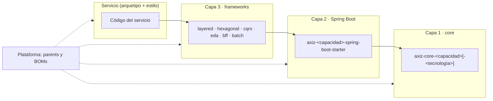

# Arquitectura

axiz separa lo que es **Java puro** de lo que es **Spring** y de lo que es **estilo
arquitectónico**, para que cada pieza se pruebe sola, se pueda cablear con otro runtime y un
servicio dependa solo de lo que usa.

- [Capas](capas.md): qué va en cada una y las reglas que lo verifican.
- [Repositorios y versiones](repositorios.md): monorepo del framework, parents, BOMs, ramas y releases.
- [Servlet y reactivo](stack.md): el stack como eje independiente del estilo.
- [Configuración y secretos](configuracion.md): ConfigMaps, Parameter Store y Secrets Manager.
- [Infraestructura AWS](aws.md): los servicios aprobados y su equivalente local.
- [Arquetipos](../arquetipos/index.md): el rol de cada servicio en el ecosistema.
