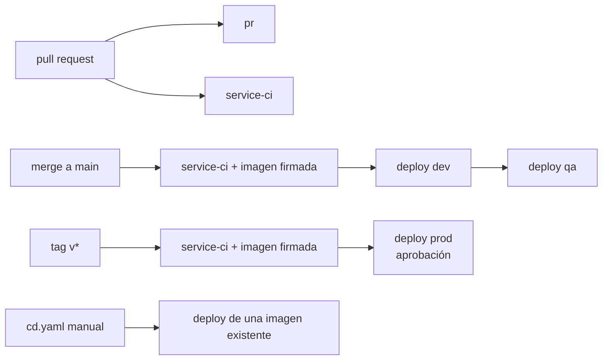

# CI/CD

Los pipelines viven como **workflows reutilizables** en `axiz-workflows`; cada repositorio solo los
invoca (`uses: axiz/axiz-workflows/.github/workflows/<workflow>.yaml@v1` con `secrets: inherit`),
así un cambio de estándar llega a todos sin tocar cada repo.

| Workflow | Disparador | Qué hace |
|---|---|---|
| `pr.yaml` | pull request | título Conventional Commits, gitleaks sobre los commits del PR, guardia de nombres, dependency review (licencias y vulnerabilidades), Semgrep (reglas públicas y de axiz), Trivy de filesystem (SARIF a code scanning), actionlint |
| `lib-publish.yaml` | PR y push | `verify -Pquality` (Spotless, Checkstyle, Error Prone + NullAway, SpotBugs/FindSecBugs, ArchUnit, JaCoCo, PIT), informe de OpenRewrite en PRs, SonarQube con quality gate, SBOM CycloneDX y su escaneo; con `stage` guarda los artefactos que pasaron todos los controles (repositorio de staging con manifiesto SHA-256) |
| `lib-promote.yaml` | push a `develop` y tags `v*` | publica en Nexus los artefactos verificados en la misma ejecución (sin recompilar), comprobados contra su manifiesto; el job que lo llama depende (`needs`) de todos los controles: build, wrapper, samples (framework) o initializr y binarios nativos (tools) |
| `service-ci.yaml` | PR y push de un servicio | lo mismo, más lint de OpenAPI y AsyncAPI (Spectral), cambios incompatibles (oasdiff), chart (helm lint, kubeconform y kube-linter por ambiente); en `main` y tags la imagen con Jib (y nativa si aplica), su escaneo, firma con cosign (llave en AWS KMS) y atestación del SBOM |
| `service-cd.yaml` | después de la imagen | despliegue GitOps del commit construido (ver [Despliegue](despliegue.md)) |
| `release.yaml` | push a `main` | release-please: PR de release con versión y changelog; al hacer merge, tag y release |
| `native.yaml` | tags de herramientas | binarios nativos de la CLI para Linux, macOS y Windows con smoke test |
| `native-nightly.yaml` | nocturno | compilación y pruebas nativas del demo y de un servicio generado por arquetipo |
| `infra.yaml` | cambios en la infraestructura del servicio | Terraform: fmt, validate, Trivy config, plan en el PR, apply con aprobación |
| Renovate | programado | PRs de dependencias y del parent de axiz (con la nota de `axiz upgrade`) |

El repositorio del framework tiene además `samples-matrix.yaml` (nocturno): genera todas las
combinaciones que ofrece el generador (arquetipo, framework, stack web y persistencia, `MODE=all`)
y construye cada proyecto con su wrapper sin ninguna configuración de AWS en el entorno. El job
`samples` de cada pull request construye solo los valores por defecto de cada arquetipo.

## El pipeline de un servicio

El `ci.yaml` generado encadena los despliegues detrás del build y la imagen del **mismo commit**;
`cd.yaml` permite promover, redesplegar o hacer rollback de una imagen ya construida.

## Reglas de seguridad

- Acceso a AWS por **OIDC** (`id-token: write`) con un rol por repositorio y ambiente; sin llaves
  de larga duración.
- Credenciales de Nexus, SonarQube y de las GitHub Apps como secretos de organización o de
  environment, nunca en archivos.
- Environments `dev`, `qa` y `prod` con revisores obligatorios en `prod`; protección de ramas y
  revisión obligatoria.
- Acciones de terceros **fijadas por SHA** (lo verifica `self-check` y Renovate las mantiene);
  permisos mínimos por job.
- Jobs que necesitan la red privada (Nexus, Argo CD) aceptan un `runner` (Actions Runner Controller
  en EKS).

## Ramas y versiones

`main` contiene lo liberado; `develop` publica SNAPSHOTs de librerías; `release/*` y `hotfix/*`
se construyen como `main`; las ramas de trabajo solo corren los checks del PR. La versión publicada
es la del tag (`-Drevision=<x.y.z>`); el pom conserva el SNAPSHOT. Los commits siguen Conventional
Commits (el título del PR es el commit al hacer squash).

## Configuración de la organización

| Tipo | Nombre | Para qué |
|---|---|---|
| Secreto | `NEXUS_URL`, `NEXUS_USERNAME`, `NEXUS_PASSWORD`, `NEXUS_DOCKER_REGISTRY` | builds e imágenes |
| Secreto (opcional) | `SONAR_HOST_URL`, `SONAR_TOKEN` | análisis y quality gate |
| Secreto (opcional) | `AXIZ_NAMING_GUARD` | identificadores prohibidos, uno por línea (fuera de todo repositorio) |
| Secreto | `GITOPS_APP_ID`, `GITOPS_APP_PRIVATE_KEY` | GitHub App que solo puede escribir en el repositorio GitOps |
| Secreto | `RELEASE_APP_ID`, `RELEASE_APP_PRIVATE_KEY` | GitHub App de release-please (sus tags disparan la publicación) |
| Secreto (opcional) | `ARGOCD_AUTH_TOKEN` | token de solo lectura del proyecto de Argo CD |
| Variable | `GITOPS_REPOSITORY`, `ARGOCD_SERVER` | despliegue |
| Variable | `COSIGN_KMS_KEY`, `COSIGN_ROLE_ARN`, `AWS_REGION` | firma de imágenes |
| Variable por environment | `TERRAFORM_ROLE_ARN`, `AWS_REGION` | infraestructura |
