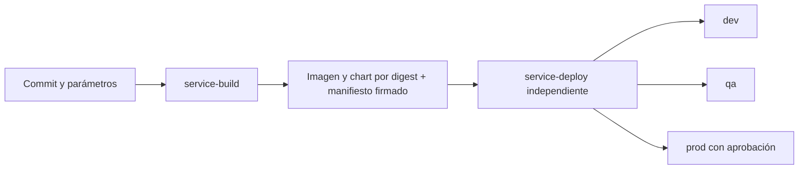

# CI/CD

Los pipelines viven como **workflows reutilizables** en `axiz-workflows`; cada repositorio solo los
invoca con una referencia versionada y un mapa explícito de los secretos declarados por el
workflow. Las actualizaciones llegan mediante una nueva release y su adopción en cada consumidor.

| Workflow | Disparador | Qué hace |
|---|---|---|
| `pr.yaml` | pull request | título Conventional Commits, gitleaks sobre los commits del PR, guardia de nombres, dependency review (licencias y vulnerabilidades), Semgrep (reglas públicas y de axiz), Trivy de filesystem (SARIF a code scanning), actionlint |
| `lib-build.yaml` | PR y push | `verify -Pquality` (Spotless, Checkstyle, Error Prone + NullAway, SpotBugs/FindSecBugs, ArchUnit, JaCoCo, PIT), informe de OpenRewrite en PRs, SonarQube con quality gate, SBOM CycloneDX y su escaneo; con `stage` guarda los artefactos que pasaron todos los controles (repositorio de staging con manifiesto SHA-256) |
| `lib-deploy.yaml` | ejecución independiente con aprobación de environment | verifica el run productor, la firma y el hash externo del manifiesto; publica los bytes ya construidos en Nexus releases sin recompilar |
| `service-build.yaml` | PR y push de un servicio | lo mismo, más lint de OpenAPI y AsyncAPI (Spectral), cambios incompatibles (oasdiff), chart (helm lint, kubeconform y kube-linter por ambiente); en `main` y tags la imagen con Jib (y nativa si aplica), su escaneo, firma con cosign (llave en AWS KMS) y atestación del SBOM |
| `service-deploy.yaml` | después de la imagen | despliegue GitOps del commit construido (ver [Despliegue](despliegue.md)) |
| `release.yaml` | push a `main` | release-please: PR de release con versión y changelog; al hacer merge, tag y release |
| `native.yaml` | tags de herramientas | binarios nativos de la CLI para Linux, macOS y Windows con smoke test |
| `native-nightly.yaml` | nocturno | compilación y pruebas nativas del demo y de un servicio generado por arquetipo |
| `infra.yaml` | cambios en la infraestructura del servicio | Terraform: fmt, validate, Trivy config, plan en el PR, apply con aprobación |
| Renovate | programado | PRs de dependencias y del parent de axiz (con la nota de `axiz upgrade`) |

El repositorio del framework tiene además `samples-matrix.yaml` (nocturno): genera todas las
combinaciones que ofrece el generador (arquetipo, estructura, extensión, stack y persistencia, `MODE=all`)
y construye cada proyecto con su wrapper sin ninguna configuración de AWS en el entorno. El job
`samples` de cada pull request construye solo los valores por defecto de cada arquetipo.

## El pipeline de un servicio

`ci.yaml` construye y valida; `deploy.yaml` consume un build terminado mediante `build-run-id`,
`build-run-attempt` y `manifest-sha256`. Los parámetros efectivos y el commit quedan en el
manifiesto; `parameters_sha256` distingue configuraciones. El deploy verifica origen, firma,
gates, hashes, digests y revisiones. Promoción y rollback reutilizan artefactos, sin ejecutar
Maven, Jib, `docker build` ni `helm package`. Las credenciales de build y de publicación/despliegue
son distintas. Una candidata ausente o expirada falla y nunca provoca una recompilación.

## Reglas de seguridad

- Acceso a AWS por **OIDC** (`id-token: write`) con un rol por repositorio y ambiente; sin llaves
  de larga duración.
- Credenciales de Nexus, SonarQube y de las GitHub Apps como secretos de organización o de
  environment, nunca en archivos.
- Environments `dev`, `qa` y `prod` con revisores obligatorios en `prod`; protección de ramas y
  revisión obligatoria.
- Acciones de terceros **fijadas por SHA** (lo verifica `self-check` y Renovate las mantiene);
  permisos mínimos por job.
- Las referencias internas usan SHA completo o una versión exacta con el requisito
  `axiz-workflows-trust`. Antes de ejecutar los jobs dependientes se consulta la release en GitHub:
  debe corresponder a la misma versión, tener `immutable: true` y no ser borrador. La ausencia de
  acceso o de una release inmutable bloquea la ejecución. Las condiciones personalizadas también
  exigen que esta comprobación termine correctamente. `check-workflow-security` valida esta
  excepción concreta y los mapas de secretos, incluidas las plantillas del generador.
- Si el repositorio de workflows es privado, configura `AXIZ_WORKFLOWS_READ_TOKEN` con permiso
  **Contents: read** exclusivamente sobre él. Sin ese secreto se usa `github.token`. Activa las
  [releases inmutables de GitHub](https://docs.github.com/en/code-security/concepts/supply-chain-security/immutable-releases)
  y publica una nueva release con los controles antes de actualizar consumidores: una release
  inmutable existente no puede sobrescribirse. El código local no configura ni acredita las
  protecciones remotas. Renovate mantiene las referencias y la versión del verificador alineadas;
  se prefiere fijarlas por SHA cuando la release publicada sea accesible.
- `check-encapsulation`, después del build de calidad, rechaza hallazgos de `EI_EXPOSE_REP`,
  `EI_EXPOSE_REP2` y `CT_CONSTRUCTOR_THROW` también cuando su prioridad es media. Sus excepciones
  deben identificar clase y campo o constructor exactos; no se admiten exclusiones globales.
- Toda herramienta que un workflow descarga (actionlint, kubeconform, kube-linter) tiene versión y
  SHA-256 fijados y se verifica antes de ejecutarse; la espera de Argo CD usa su API REST con
  `curl`, sin descargar su CLI.
- Firma obligatoria de imágenes, procedencia SLSA de imágenes y de releases de librerías (firmada
  con la llave de KMS y adjunta a la release de GitHub), SBOM en cada build.
- El wrapper de Maven verifica la distribución contra el SHA-512 fijado en
  `maven-wrapper.properties` antes de ejecutarla.
- Jobs que necesitan la red privada (Nexus, Argo CD) aceptan un `runner` (Actions Runner Controller
  en EKS).

## Ramas y versiones

`main` es la referencia estable. El build recibe el commit y la versión final explícitos,
y registra los parámetros efectivos y sus hashes. Una etiqueta de candidata identifica un intento
con coordenadas finales; no crea una segunda versión del mismo producto. Su consumo requiere la
identidad del run y el hash del manifiesto, con repositorio local aislado. La publicación final
usa el tag de release correspondiente a la versión construida y el workflow de deploy separado.
Un push a una rama de desarrollo no equivale a publicar una release. Los commits y títulos de PR
siguen Conventional Commits; la versión de cada servicio evoluciona independientemente de Axiz.

Un proyecto nuevo nace con el pom en `0.1.0-SNAPSHOT` y el chart en `0.1.0`, que es la versión
hacia la que trabaja. `version.txt` y `.release-please-manifest.json` guardan otra cosa: la última
versión liberada, y nacen en `0.0.0` porque todavía no hay ninguna. Ponerlos en `0.1.0` declararía
un release que no existe (sin tag `v0.1.0`). Mientras no hay release, release-please no calcula la
versión desde los commits: usa `initial-version`, que la plantilla fija en `0.1.0` (sin ese valor
propondría `1.0.0`). Desde ahí cada release sigue Conventional Commits: un `fix:` sube el parche, un
`feat:` la menor y un cambio incompatible (`feat!:` o `BREAKING CHANGE`) la mayor. La Initializr
sube el proyecto con el commit `feat: generate <nombre> with axiz initializr`, que abre el
changelog. `pr.yaml` comprueba que `version.txt` y el manifiesto coincidan y que el pom no esté por
detrás de la versión liberada, y el CI del framework calcula con release-please esos casos sobre la
plantilla (`.github/scripts/release-version`).

## Configuración de la organización

| Tipo | Nombre | Para qué |
|---|---|---|
| Secreto | `NEXUS_URL`, `NEXUS_READ_USERNAME`, `NEXUS_READ_PASSWORD`, `NEXUS_PUBLISH_USERNAME`, `NEXUS_PUBLISH_PASSWORD`, `NEXUS_DOCKER_REGISTRY` | builds e imágenes |
| Secreto (opcional) | `SONAR_HOST_URL`, `SONAR_TOKEN` | análisis y quality gate |
| Secreto | `AXIZ_NAMING_GUARD` | identificadores prohibidos, uno por línea (fuera de todo repositorio); `pr.yaml` falla si falta, salvo `AXIZ_NAMING_GUARD_OPTIONAL=true` |
| Secreto | `GITOPS_APP_ID`, `GITOPS_APP_PRIVATE_KEY` | GitHub App que solo puede escribir en el repositorio GitOps |
| Secreto | `RELEASE_APP_ID`, `RELEASE_APP_PRIVATE_KEY` | GitHub App de release-please (sus tags disparan la publicación) |
| Secreto (opcional) | `ARGOCD_AUTH_TOKEN` | token de solo lectura del proyecto de Argo CD |
| Variable | `GITOPS_REPOSITORY`, `ARGOCD_SERVER` | despliegue |
| Variable | `COSIGN_KMS_KEY`, `COSIGN_ROLE_ARN`, `AWS_REGION` | firma de imágenes y atestaciones (SBOM, procedencia SLSA); obligatorias |
| Variable (repositorio) | `AXIZ_API_BASELINE` | versión v2 publicada para comparación; la primera 2.0.0 usa inventario de firmas aprobado y verifica que aún no exista en el repositorio final |
| Variable por environment | `TERRAFORM_ROLE_ARN`, `AWS_REGION` | infraestructura |
