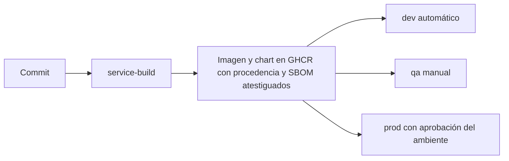

# CI/CD

Los pipelines son **workflows reutilizables** del monorepo `edgarrth/java-framework-custom` que
cada servicio o librería invoca fijados por el tag inmutable de su release
(`axiz-workflows-vX.Y.Z`). Se apoyan en funciones nativas de GitHub (atestaciones de artefactos,
ambientes con reglas de protección, CodeQL, revisión de dependencias, secret scanning) y en
herramientas estándar (Maven, Jib, Helm, Trivy, oasdiff); no hay acciones propias.

| Workflow | Disparador | Qué hace |
|---|---|---|
| `service-build.yaml` | pull request y push del servicio | `verify -Pquality` (Spotless, Checkstyle, Error Prone con NullAway, SpotBugs con FindSecBugs, ArchUnit, JaCoCo, PIT), compatibilidad del contrato OpenAPI (oasdiff), chart (helm lint y kubeconform por ambiente) y escaneo del SBOM; en `main` y en los tags, imagen con Jib en GHCR, escaneo por digest, chart OCI y atestaciones de procedencia y SBOM |
| `service-deploy.yaml` | después del build en `main` (dev) o manual | verifica la atestación del digest con `gh attestation verify` y escribe el estado deseado en el repositorio GitOps (ver [Despliegue](despliegue.md)) |
| `lib-build.yaml` | pull request y push de una librería | `verify -Pquality` y escaneo del SBOM; con un tag, `deploy` a GitHub Packages con procedencia atestiguada de cada jar |
| `release.yaml` | push a `main` | release-please: pull request de release con versión y changelog; al fusionarlo, tag y release |
| Renovate | programado | pull requests de dependencias y del parent de axiz (con la nota de `axiz upgrade`) |

El contrato completo de entradas, salidas y permisos está en `.github/docs/pipelines.md`.

## El pipeline de un servicio

`ci.yaml` construye, valida y publica; en `main` despliega en dev cuando el repositorio define
`AXIZ_GITOPS_REPOSITORY`. `deploy.yaml` promueve un digest ya construido a otro ambiente. Promover
y volver atrás reutilizan la misma imagen, sin ejecutar Maven ni Jib.

## Reglas de seguridad

- Acciones de terceros **fijadas por SHA** con el comentario de su versión; Renovate las mantiene.
  Los workflows de Axiz se fijan por el tag de una release inmutable.
- Permisos mínimos por job: `packages: write`, `id-token: write` y `attestations: write` solo en
  los jobs que publican.
- Sin caché de dependencias en los jobs que publican, para evitar el envenenamiento de caché.
- `actionlint` y `zizmor` revisan los workflows en cada pull request.
- Ambientes `dev`, `qa` y `prod` con revisores requeridos en `prod` y ramas permitidas; el job de
  despliegue no empieza hasta cumplirlas.
- Toda imagen se publica con su procedencia SLSA y su SBOM como atestaciones de GitHub;
  `service-deploy` y la política de admisión de Kyverno las verifican.
- Una vulnerabilidad MEDIUM, HIGH o CRITICAL rompe el build. Las excepciones viven en
  `.trivyignore.yaml` con justificación y fecha de vencimiento, y las revisa el code owner.
- El wrapper de Maven verifica la distribución contra el SHA-512 fijado en
  `maven-wrapper.properties` antes de ejecutarla.
- Un cambio incompatible en el contrato OpenAPI rompe el pull request, salvo que se acepte de forma
  explícita en `src/main/openapi/breaking-changes.txt`, que revisa el code owner.
- `security.yaml` ejecuta CodeQL, la revisión de dependencias, Trivy y las reglas Semgrep de axiz
  en cada pull request, en `main` y semanalmente; los resultados quedan en code scanning.

## Ramas y versiones

`main` es la referencia estable. Los commits y títulos de pull request siguen Conventional
Commits; la versión de cada servicio evoluciona independientemente de Axiz.

Un proyecto nuevo nace con el pom en `0.1.0-SNAPSHOT` y el chart en `0.1.0`, que es la versión
hacia la que trabaja. `version.txt` y `.release-please-manifest.json` guardan la última versión
liberada y nacen en `0.0.0`, porque todavía no hay ninguna. Mientras no hay release,
release-please usa `initial-version`, que la plantilla fija en `0.1.0` (sin ese valor propondría
`1.0.0`). Desde ahí cada release sigue Conventional Commits: un `fix:` sube el parche, un `feat:`
la menor y un cambio incompatible (`feat!:` o `BREAKING CHANGE`) la mayor. La Initializr sube el
proyecto con el commit `feat: generate <nombre> with axiz initializr`, que abre el changelog.

## Configuración del repositorio

| Tipo | Nombre | Para qué |
|---|---|---|
| Token automático | `GITHUB_TOKEN` | lectura de GitHub Packages; publicación de paquetes, imágenes, charts y atestaciones |
| Secretos | `RELEASE_APP_CLIENT_ID`, `RELEASE_APP_PRIVATE_KEY` | GitHub App de release-please (sus tags disparan la publicación) |
| Secretos | `GITOPS_APP_CLIENT_ID`, `GITOPS_APP_PRIVATE_KEY` | GitHub App que solo puede escribir en el repositorio GitOps |
| Variable | `AXIZ_GITOPS_REPOSITORY` | repositorio GitOps `owner/name`; sin ella no hay despliegue automático en dev |
| Variable opcional | `AXIZ_BASE_IMAGE` | imagen base fijada por digest; por defecto la del POM |
| Variable opcional | `AXIZ_NATIVE` | `true` para compilar y publicar la imagen nativa |

## Componentes del monorepo

`edgarrth/java-framework-custom` contiene framework, herramientas, documentación y workflows,
con versiones independientes y los tags `axiz-framework-vX.Y.Z`, `axiz-tools-vX.Y.Z`,
`axiz-docs-vX.Y.Z` y `axiz-workflows-vX.Y.Z`. Sus productos llaman a los workflows reutilizables
desde el mismo commit, así que sus checks funcionan antes de cualquier release. El procedimiento
de publicación está en `RELEASING.md`, en la raíz del repositorio.
